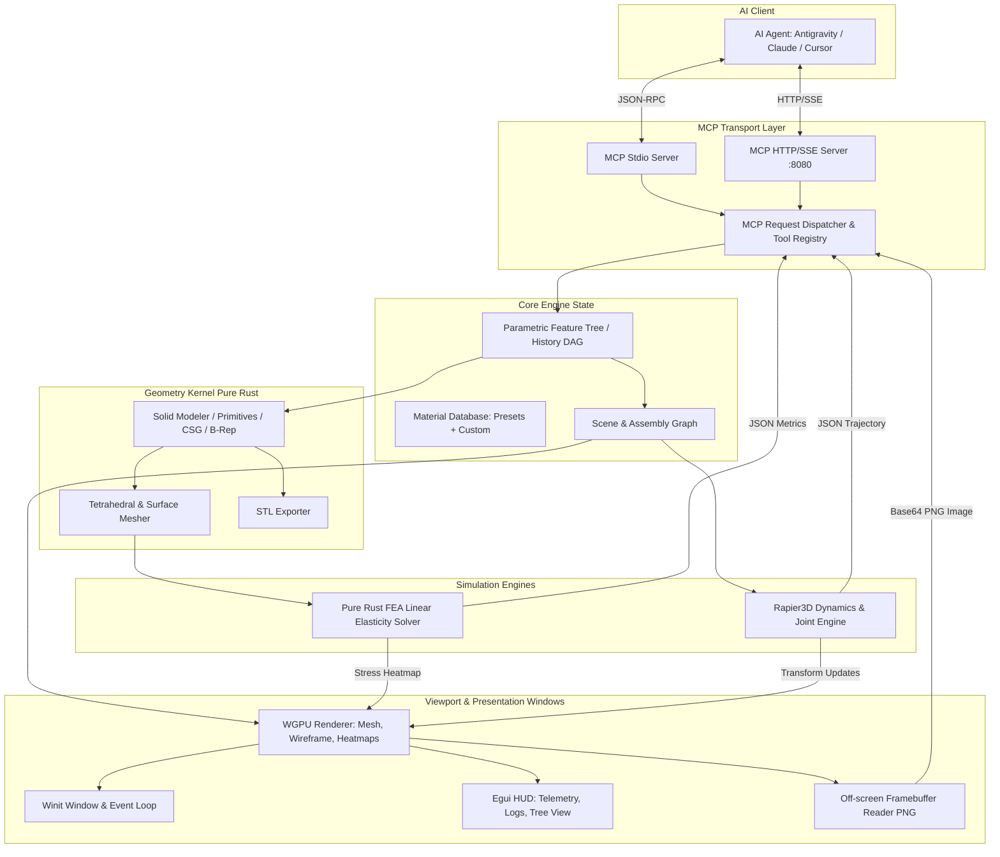

# PRD: MCP-CAD Engine (Rust AI-Native CAD/CAE System)

## 1. Введение и Видение Продукта

### 1.1. Проблема
Традиционные CAD/CAE пакеты (SolidWorks, FreeCAD, Fusion 360, ANSYS) создавались исключительно для взаимодействия с человеком через сложный графический интерфейс (GUI) с сотнями кнопок, модальных окон и манипуляций мышью. Интеграция больших языковых моделей (LLM) и автономных агентов с такими пакетами затруднена: API либо перегружены, либо закрыты, либо требуют громоздких внешних скриптовых прослоек. 
В то же время чисто генеративные 3D-модели (полигональные меши из text-to-3D) непригодны для инженерного применения: у них нет точной геометрии, невозможно задать сопряжения деталей механизма и невозможно провести достоверный расчет прочности.

### 1.2. Видение (Product Vision)
**MCP-CAD Engine** — это автономная инженерная среда на языке **Rust под Windows**, изначально спроектированная под прямое управление ИИ-агентами по протоколу **Model Context Protocol (MCP)**.
Программа сочетает:
1. **Точное параметрическое твердотельное моделирование (Solid B-Rep DAG)** на чистом стеке Rust без тяжелых C++ зависимостей.
2. **Симуляцию динамики механизмов в реальном времени** (шарниры, приводы, коллизии на базе Rapier3D).
3. **Линейный статический анализ прочности (FEA / МКЭ)** с расчетом напряжений по Мизесу и коэффициента запаса прочности.
4. **Гибридную визуализацию**: нативное легковесное 3D-окно (WGPU + Winit) для наблюдения человеком в реальном времени + оффскрин-рендеринг снимков для зрения мультимодальных LLM.
5. **Замкнутый цикл инженерной оптимизации для ИИ**: `Спроектировать -> Протестировать кинематику -> Рассчитать нагрузки -> Скорректировать геометрию -> Экспортировать в STL`.

---

## 2. Персоны и Пользовательские Сценарии (Use Cases)

### 2.1. Персоны
- **Автономный ИИ-Инженер (AI Agent via MCP)**: Claude, Antigravity, Cursor, локальные LLM, подключающиеся по stdio или HTTP/SSE. ИИ выступает ведущим конструктором и расчетчиком.
- **Инженер-Наблюдатель (Human Supervisor)**: Человек, сидящий перед монитором Windows, который ставит высокоуровневые задачи ИИ и визуально наблюдает за 3D-сценой, анимацией механизмов и эпюрами напряжений.

### 2.2. Ключевые сценарии использования (User Stories)
1. **Сценарий 1: Проектирование силового кронштейна с оптимизацией веса и прочности**
   - Пользователь просит ИИ: *"Создай угловой кронштейн под нагрузку 800 Н из алюминия 6061-T6 с коэффициентом запаса не менее 2.0"*.
   - ИИ вызывает MCP-инструменты: строит базовую форму (экструзия, отверстия), прикрепляет материал.
   - ИИ запускает `run_fea_analysis`: фиксирует опорные отверстия, прикладывает силу 800 Н.
   - Движок возвращает JSON с `max_von_mises_mpa: 85.0`, `safety_factor: 3.2` и генерирует скриншот цветовой шкалы напряжений.
   - ИИ видит избыточный запас прочности, добавляет операции облегчения (вырезы) через параметрическое дерево (DAG), повторно запускает расчет (`safety_factor: 2.1`), убеждается в прочности и экспортирует модель в STL для 3D-печати.

2. **Сценарий 2: Сборка и симуляция кинематики механизма (например, кривошипно-шатунного)**
   - Пользователь просит: *"Собери механизм с вращающимся приводом и поршнем"*.
   - ИИ создает отдельные твердотельные детали (`base`, `crank`, `rod`, `piston`).
   - ИИ накладывает кинематические сочленения (`create_joint`): вращательные (revolute) и призматические (prismatic/slider).
   - ИИ запускает `run_physics_simulation(duration_s=5.0, motor_speed=10.0)`: движок в окне WGPU анимирует движение, а ИИ получает телеметрию (траектории, максимальные реактивные силы в шарнирах, коллизии).

3. **Сценарий 3: Мультимодальный визуальный аудит**
   - В любой момент ИИ может вызвать `capture_viewport(camera_angle="isometric")` и получить изображение сцены или тепловой карты деформаций для валидации глазом нейросети.

---

## 3. Архитектура Системы

Система строится по модульной архитектуре на языке Rust с разделением ответственности:

---

## 4. Спецификация Подсистем

### 4.1. Геометрическое ядро и Параметрическое дерево (DAG)
- **Стек**: Чистый Rust (`truck-modeling`, `truck-geometry` / кастомные параметрические полиэдральные примитивы и B-Rep топология).
- **Структура дерева (DAG)**:
  - Каждая деталь имеет уникальный `part_id` и последовательность шагов-операций (`FeatureNode`).
  - Типы операций:
    - `AddBox(width, height, depth)`
    - `AddCylinder(radius, height)`
    - `AddSphere(radius)`
    - `ExtrudeSketch(profile_2d, depth)`
    - `CutHole(center, radius, depth)`
    - `Fillet / Chamfer(edges, radius)`
    - `BooleanUnion`, `BooleanDifference`, `BooleanIntersection`
    - `Transform(translation, rotation, scale)`
  - **Редактирование параметров**: ИИ может вызвать `modify_feature(part_id, feature_id, params)`, что вызывает автоматический пересчет геометрии детали от измененного узла вниз по графу.

### 4.2. Подсистема динамики механизмов (Rigid Body & Joints)
- **Стек**: `rapier3d` (чистый Rust).
- **Возможности**:
  - Автоматическое вычисление массы, центра масс и тензора инерции твердого тела по его триангулированной геометрии и плотности материала.
  - Генерация коллайдеров: выпуклые оболочки (`ConvexHull`), составные примитивы (`Compound`) или тримеши (`TriMesh`).
  - Сочленения (Joints):
    - `Revolute` (шарнир с вращением вокруг заданной оси, лимиты углов, мотор скорости/момента).
    - `Prismatic` (направляющий слайдер вдоль оси с лимитами хода).
    - `Spherical` (шаровой шарнир).
    - `Fixed` (жесткое закрепление двух деталей).
    - `Gear` (кинематическое зубчатое зацепление с синхронизацией угловых скоростей $\omega_B = -\text{ratio} \cdot \omega_A$, отключением паразитных полигональных коллизий между шестернями и передачей вращения).
  - Поддержка статической фиксации (`is_fixed: bool`) и сопряжений с неподвижным пространством (`"ground"` / `"world"`).
  - Сбор данных симуляции:
    - Запись положения и скоростей тел по шагам времени ($\Delta t = 1/60$ с).
    - Расчет пиковых нагрузок и реакций в сочленениях.
    - Детекция соударений и заклиниваний.
    - Генерация ключевых кадров полигональной сетки для визуализатора.

### 4.3. Подсистема прочностных расчетов (МКЭ / FEA)
- **Стек**: Чистый Rust (`nalgebra` / `faer` для разреженных матриц, кастомный 3D тетраэдральный МКЭ-солвер).
- **Мешинг**: Тетраэдризация объема твердого тела (TET4: 4-узловые линейные тетраэдры).
- **Математическая модель**:
  - Линейная изотропная теория упругости: закон Гука $\sigma = D \cdot \varepsilon$.
  - Локальная матрица жесткости тетраэдра $K_e = \int B^T D B \, dV = V_e B^T D B$.
  - Глобальная матрица жесткости $K$ в разреженном формате (CSR/CRS).
  - Граничные условия:
    - Закрепления (условия Дирихле $u_i = 0$ на узлах опорных граней/отверстий).
    - Нагрузки (условия Неймана: точечные, поверхностные силы $F$ или давление).
  - Решение системы $K \cdot u = F$ методом сопряженных градиентов (Conjugate Gradient) или разреженным разложением Холецкого.
  - Вычисление напряжений: тензор напряжений Коши $\sigma$, главные напряжения $\sigma_1, \sigma_2, \sigma_3$, эквивалентное напряжение по Мизесу:
    $$\sigma_{vM} = \sqrt{\frac{1}{2}\left[(\sigma_x - \sigma_y)^2 + (\sigma_y - \sigma_z)^2 + (\sigma_z - \sigma_x)^2 + 6(\tau_{xy}^2 + \tau_{yz}^2 + \tau_{zx}^2)\right]}$$
  - Расчет запаса прочности:
    $$FoS = \frac{\sigma_{yield}}{\max(\sigma_{vM})}$$
  - Результаты:
    1. Текстово-числовой JSON для ИИ (критические узлы, пиковые напряжения, вердикт "PASS/FAIL").
    2. Поле деформаций и раскраска сетки для WGPU-визуализатора (градиент от синего к красному).

### 4.4. Инженерная база материалов
Встроенные пресеты с физико-механическими параметрами:
| Имя материала | Модуль Юнга $E$ (ГПа) | Коэф. Пуассона $\nu$ | Предел текучести $\sigma_y$ (МПа) | Плотность $\rho$ (кг/м³) | Назначение |
|---|---|---|---|---|---|
| `steel_structural_aisi1020` | 205.0 | 0.29 | 250.0 | 7850 | Конструкционная сталь |
| `steel_high_strength_4140` | 210.0 | 0.30 | 655.0 | 7850 | Валы, высоконагруженные оси |
| `aluminum_6061_t6` | 68.9 | 0.33 | 276.0 | 2700 | Авиационный/силовой алюминий |
| `titanium_grade5_ti6al4v` | 114.0 | 0.34 | 880.0 | 4430 | Легкие высокопрочные узлы |
| `brass_c360` | 100.0 | 0.34 | 310.0 | 8500 | Втулки, шестерни скольжения |
| `pla_filament_3dprint` | 3.5 | 0.36 | 60.0 | 1240 | 3D-печать прототипов |
| `petg_filament_3dprint` | 2.1 | 0.38 | 50.0 | 1270 | 3D-печать прочных деталей |
| `nylon_pa12` | 1.8 | 0.40 | 45.0 | 1010 | Износостойкие механизмы, петли |

ИИ может добавлять собственные материалы через инструмент `define_material`.

### 4.5. Визуализация и Окно на Windows
- **Стек**: `wgpu`, `winit`, `egui`.
- **Графический пайплайн**:
  - Рендеринг затененных твердых тел (PBR/Blinn-Phong) с контурными линиями граней (CAD-стиль).
  - Рендеринг сочленений: оси шарниров, векторы приводов, маркеры степеней свободы.
  - Рендеринг результатов МКЭ: деформированная геометрия с масштабируемым коэффициентом деформации (scale factor), цветовая карта напряжений по Мизесу с легендой значений в МПа.
  - Воспроизведение анимации симуляции механизмов (Loop playback) в окне WGPU с обновлением вершинных буферов на GPU на лету и горячей клавишей паузы/продолжения (`P`).
  - Оффскрин-рендеринг в память без показа окна (для тестов или фонового режима) и по требованию ИИ (`capture_viewport`).

### 4.6. Транспорт MCP
- **Двойной режим**:
  1. `stdio`: стандартный запуск как дочернего процесса (JSON-RPC 2.0). Весь лог пишется строго в `stderr`, `stdout` выделен под протокол.
  2. `sse / stream`: локальный HTTP сервер (например, `axum` на `127.0.0.1:8080`) для подключения внешних агентов без перезапуска окна программы.

---

## 5. Спецификация инструментов MCP (Tools API)

Ниже представлен базовый контракт инструментов, предоставляемых ИИ-агенту:

### 5.1. Управление сценой и деталями
- `create_part(name: string, material: string, is_fixed?: bool) -> { part_id: string, is_fixed: bool }`
  Создает новую деталь с привязкой к материалу и опциональной фиксацией в мировом пространстве (статическое тело).
- `list_parts() -> { parts: [...] }`
  Возвращает список деталей, их габариты, объемы, массы и статус.
- `delete_part(part_id: string) -> { status: "deleted" }`

### 5.2. Параметрическое моделирование (DAG-операции)
- `add_feature_primitive(part_id: string, primitive_type: "box"|"cylinder"|"sphere"|"cone"|"polygon_prism"|"spur_gear"|"revolve"|"wheel_rim", params: object) -> { feature_id: string }`
  Добавляет базовый твердотельный объем.
- `apply_boolean(part_id: string, target_feature_id: string, tool_feature_id: string, op: "union"|"difference"|"intersection") -> { feature_id: string }`
  Выполняет булеву операцию между телами.
- `cut_hole(part_id: string, position: [f32; 3], normal: [f32; 3], radius: f32, depth: f32, keyway_width?: f32, keyway_depth?: f32) -> { feature_id: string }`
  Отверстие под вал, крепеж или ось со шпоночным пазом.
- `modify_feature(part_id: string, feature_id: string, new_params: object) -> { status: "updated", updated_bounds: [...] }`
  Редактирование любого параметра в истории построения.
- `get_feature_tree(part_id: string) -> { dag: [...] }`
  Получение полной структуры дерева операций детали.

### 5.3. Механизмы и кинематика
- `create_joint(joint_type: "revolute"|"prismatic"|"spherical"|"fixed"|"gear", part_a: string, part_b: string, anchor_a?: [f32; 3], anchor_b?: [f32; 3], axis?: [f32; 3], ratio?: f32, teeth_a?: u32, teeth_b?: u32, limits?: object) -> { joint_id: string }`
  Создание кинематического сопряжения между деталями (поддерживает привязку к неподвижному пространству `"ground"`/`"world"` и зубчатые зацепления `"gear"`).
- `set_joint_motor(joint_id: string, target_velocity: f32, max_force: f32) -> { status: "motor_active" }`
  Включение привода (вращение или линейный сдвиг).
- `run_physics_simulation(duration_seconds: f32, step_size_ms: f32) -> { success: bool, trajectory_summary: object, peak_joint_forces: object, collisions: [...] }`
  Запуск физической симуляции в Rapier3D с записью телеметрии и автоматической отправкой кадров анимации в окно предварительного просмотра.

### 5.4. Расчет прочности (FEA)
- `run_fea_analysis(part_id: string, mesh_density: "coarse"|"medium"|"fine", fixed_faces: [...], applied_forces: [{ position: [f32; 3], force_vector: [f32; 3] }]) -> { max_von_mises_mpa: f32, yield_strength_mpa: f32, safety_factor: f32, max_displacement_mm: f32, status: "PASS"|"FAIL" }`
  Запуск тетраэдризации и линейного МКЭ расчета.
- `get_fea_heatmap_image(part_id: string, camera_preset: "front"|"iso"|"top") -> { image_base64: string, colormap_legend: object }`
  Получение рендера напряжений для визуального анализа LLM.

### 5.5. Визуализация и экспорт
- `capture_viewport(camera_preset: string, width: u32, height: u32) -> { image_base64: string }`
  Снимок текущего состояния 3D-сцены.
- `open_preview_window(part_id?: string) -> { status: "opened", mode: string }`
  Открытие интерактивного нативного окна 3D превью на Windows с орбитальной камерой, переключением качества тесселяции (`Q`) и циклическим воспроизведением симуляции (`P`).
- `export_stl(part_id: string, filepath: string, binary: bool) -> { file_path: string, triangles_count: u32 }`
  Экспорт в стандартный STL файл для производства/3D-печати.
- `get_simulation_metrics_json() -> { current_metrics: object }`
  Экспорт полного инженерного отчета в формате JSON.

---

## 6. Нефункциональные требования (NFR)

1. **Производительность**:
   - Время пересчета геометрии детали средней сложности (до 50 операций): $< 100$ мс.
   - Физическая симуляция Rapier3D: $\ge 60$ FPS для механизмов до 50 подвижных тел.
   - МКЭ-расчет детали до 20 000 тетраэдров: $< 3$ секунд.
2. **Безопасность выполнения (Crash Resilience & Timeouts)**:
   - Лимит времени на МКЭ расчет (по умолчанию 10 с), чтобы предотвратить блокировку MCP-сервера при перегрузке.
   - Лимит на число элементов сетки (по умолчанию до 50 000 тетраэдров в MVP).
3. **Чистый Rust стек (Zero C++ dependency)**:
   - Сборка через стандартный `cargo build --release` на Windows без необходимости установки CMake, LLVM/Clang или сторонних C++ SDK.
4. **Стандарты протокола**:
   - Полная совместимость с официальной спецификацией Model Context Protocol (JSON-RPC 2.0).
5. **Тестирование и Надежность (Test Coverage)**:
   - Комплексное покрытие модульными и интеграционными тестами (`cargo test --all`).
   - Аналитические тесты верификации МКЭ (сравнение с формулами сопромата).
   - Тесты сочленений и кинематических пар механизмов.
   - Тесты контракта и схемы всех MCP-инструментов.
6. **Версионирование и Git-культура**:
   - Атомарные коммиты по стандарту Conventional Commits (`feat:`, `fix:`, `test:`, `docs:`).
   - Фиксация каждого завершенного модуля и этапа в Git.

---

## 7. Документация и готовность к Open Source (GitHub Readiness)

Проект изначально оформляется как публичный Open Source проект на GitHub с наивысшим качеством документации, чтобы любой разработчик или исследователь мог запустить его за 2 минуты:
1. **Главный `README.md`**:
   - Описание проекта, бейджи сборки и тестов, GIF/скриншоты работы WGPU-окна и тепловых карт FEA.
   - Быстрый старт: установка Rust, клонирование, `cargo run`.
   - Инструкция по подключению к **Claude Desktop** (готовый блок для `claude_desktop_config.json`).
   - Инструкция по подключению к **Cursor**, **Antigravity** и кастомным скриптам через stdio / SSE.
   - Таблица доступных MCP-инструментов с описанием параметров.
2. **Каталог документации `docs/`**:
   - `docs/ARCHITECTURE.md`: подробное описание подсистем (DAG, WGPU, Rapier3D, FEA).
   - `docs/MCP_API_REFERENCE.md`: полная спецификация каждого инструмента с примерами JSON-RPC вызовов и ответов.
   - `docs/TUTORIAL.md`: пошаговый гайд «Как попросить Claude спроектировать деталь и оптимизировать ее прочность».
3. **Каталог примеров `examples/`**:
   - Готовые тестовые сценарии: кронштейн под нагрузку, кривошипно-шатунный механизм, 4-звенник.
   - Готовые промпты для ИИ-агентов.

---

## 8. Этапы разработки (Roadmap)

- **Этап 1: Фундамент и каркас (MVP-1)**
  - Инициализация Cargo workspace (`mcp-cad-core`, `mcp-cad-fea`, `mcp-cad-physics`, `mcp-cad-viewer`, `mcp-cad-server`).
  - Реализация параметрического дерева (DAG) для базовых твердотельных примитивов и операций.
  - Рендерер WGPU + Winit: окно на Windows, орбитальная камера, освещение, offscreen capture.
  - Базовый MCP Stdio сервер с инструментами моделирования и снятия скриншотов.

- **Этап 2: Физика механизмов (MVP-2)**
  - Интеграция `rapier3d`.
  - Модуль сочленений (`JointManager`), расчет массы и инерции по геометрии.
  - MCP инструменты симуляции движения, моторов и детекции коллизий.
  - Визуализация анимации движения в реальном времени в окне WGPU.

- **Этап 3: МКЭ Модуль прочности (MVP-3)**
  - Генератор 3D-тетраэдральной сетки (TET4) на чистом Rust.
  - Решатель линейной упругости (сборка матрицы жесткости, разреженный решатель $K u = F$).
  - Вычисление напряжений по Мизесу и коэффициента запаса (FoS).
  - Шейдер тепловой карты напряжений в WGPU и экспорт JSON-метрик.

- **Этап 4: Интеграция, экспорт и оптимизация для ИИ (MVP-4)**
  - Экспорт в STL.
  - Замкнутый цикл: ИИ оптимизирует толщину стенки/диаметр отверстия на основе результатов FEA.
  - Поддержка сетевого HTTP/SSE режима (`--port 8080`).
  - Набор тестовых примеров (кронштейн, шарнирный 4-звенник, редуктор) и бенчмарки.
