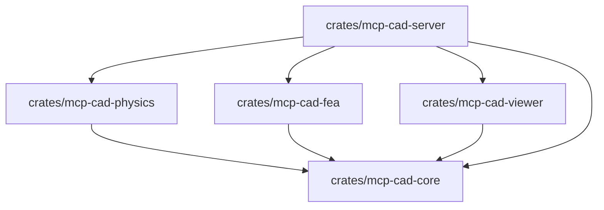

# PROJECT_CONTEXT: MCP-CAD Engine

> **Единый источник правды (Single Source of Truth) для инженерных субагентов проекта.**  
> Любая разработка, рефакторинг и добавление модулей должны соответствовать спецификациям, соглашениям и контрактам, описанным в этом документе.

---

## 1. Обзор проекта и Видение

**MCP-CAD Engine** — автономная инженерная 3D CAD/CAE система на языке **Rust под Windows**, изначально спроектированная под управление искусственным интеллектом (AI Agents) через протокол **Model Context Protocol (MCP)**.

Система реализует замкнутый инженерный цикл ИИ-агента:
$$\text{Проектирование (Solid DAG)} \longrightarrow \text{Симуляция динамики (Rapier3D)} \longrightarrow \text{Анализ прочности (FEA/МКЭ)} \longrightarrow \text{Визуальный аудит (WGPU)} \longrightarrow \text{Экспорт (STL)}$$

### Ключевые возможности
1. **Solid Modeling DAG (B-Rep / CSG)**: Параметрическое дерево построения деталей с возможностью отката и изменения параметров любого шага в истории без потери топологии.
2. **Кинематика и физика механизмов (Rapier3D)**: Твердые тела, сочленения (Revolute, Prismatic, Spherical, Fixed), моторы, расчет реакций и телеметрии.
3. **Линейный МКЭ-анализ (FEA Linear Elasticity)**: Автоматическая 3D тетраэдризация (TET4), расчет матрицы жесткости ($K \cdot u = F$), вычисление эквивалентных напряжений Мизеса и коэффициента запаса прочности ($FoS$).
4. **WGPU 3D Viewport & Headless Render**: Нативное окно Windows с CAD-шейдингом и тепловыми картами деформаций/напряжений + оффскрин-рендеринг в PNG/Base64 для мультимодальных LLM.
5. **Двойной транспорт MCP**: Поддержка `stdio` (для локального встраивания в Claude Desktop, Antigravity, Cursor) и `HTTP/SSE` (для распределенного взаимодействия через порт `8080`).

---

## 2. Целевая платформа и технологический стек

- **Операционная система**: Windows 10/11 x64 (целевая платформа; кроссплатформенный код приветствуется).
- **Язык разработки**: Rust (компилятор Rust $\ge 1.80$, Edition 2021).
- **Философия зависимостей**: **Pure Rust (Zero C++ dependency)**. Сборка не должна требовать MSVC C++ SDK, CMake, Clang или внешних бинарных DLL. Все математические, геометрические, физические и графические вычисления производятся в Rust.

---

## 3. Архитектура Cargo Workspace

Проект организован как Cargo Workspace из 5 модульных крейтов:

```
c:\Users\voley\Documents\3D_MCP/
├── Cargo.toml                    # Корневой workspace манифест
├── PRD.md                        # Product Requirements Document
├── PROJECT_CONTEXT.md            # Данный контекст проекта
└── crates/
    ├── mcp-cad-core/             # Геометрическое ядро, B-Rep/CSG примитивы, DAG, материалы, STL
    ├── mcp-cad-physics/          # Интеграция Rapier3D, сочленения, моторы, симуляция
    ├── mcp-cad-fea/              # Тетраэдризация (TET4), МКЭ решатель, Мизес, FoS
    ├── mcp-cad-viewer/           # Графический пайплайн WGPU/Winit, шейдеры, offscreen снимки
    └── mcp-cad-server/           # Точка входа (main), MCP сервер (stdio/SSE), диспетчер инструментов
```

### Граф зависимостей между крейтами



---

## 4. Спецификация подсистем (Крейты)

### 4.1. `crates/mcp-cad-core`
- **Назначение**: Фундаментальные типы данных, параметрическое дерево операций, библиотека материалов, поверхностный мешинг и экспорт.
- **Основные компоненты**:
  - `material`: Структура `Material` ($E$, $\nu$, $\sigma_y$, $\rho$), реестр встроенных материалов (`steel_structural_aisi1020`, `aluminum_6061_t6`, `titanium_grade5_ti6al4v`, `pla_filament_3dprint` и др.) и поддержка кастомных материалов.
  - `topology`: Представление полигональной сетки (`TriangleMesh`: вершины, нормали, индексы граней, UV).
  - `dag`: Параметрическое дерево операций (`FeatureTree`, `FeatureNode`). Поддерживает добавление узлов, модификацию параметров узла и линейный/направленный пересчет геометрии детали.
  - `primitives`: Твердотельные примитивы:
    - `create_box(width, height, depth)`: Параллелепипед с центрированием в начале координат.
    - `create_cylinder(radius, height, segments)`: Цилиндр вдоль оси Z.
    - `create_sphere(radius, sectors, stacks)`: UV-сфера.
    - `create_cone(radius_bottom, radius_top, height, segments)`: Конус и усеченный конус.
    - `create_polygon_prism(sides, height, width_across_flats, radius, chamfer)`: Правильная $N$-гранная призма (шестигранник DIN 934) с плоскими нормалями и торцевыми коническими фасками.
    - `create_spur_gear(module, teeth, pressure_angle, face_width, bore_radius, keyway_width, keyway_depth, hub_diameter, hub_length)`: Эвольвентная шестерня DIN 867 / ISO 53 со ступицей, отверстием и шпоночным пазом DIN 6885.
    - `create_revolve(profile, angle_deg, segments)`: Тело вращения из 2D-профиля $[r, z]$ вокруг оси Z.
    - `create_wheel_rim(...)`: Автомобильный легкосплавный колесный диск (ISO/ETRTO) со ступенчатым профилем обода, закраинами, ступицей, PCD разболтовкой и вентилируемыми спицами.
    - `create_helical_cutter(...)`: Кинематическая фреза для винтовых канавок и метрической резьбы 60° (ISO 68-1).
    - `cut_hole(mesh, center, normal, radius, depth, keyway_width, keyway_depth)`: Сверление цилиндрических отверстий с поддержкой шпоночного паза.
  - `csg`: Булевы операции над сетками (`Union`, `Difference`, `Intersection`).
  - `part`: `Part` (идентификатор `part_id`, имя, материал, трансформация, `FeatureTree`, сгенерированный меш, вычисленные масса и тензор инерции).
  - `export`: Генератор стандартного STL формата (бинарный и ASCII).

### 4.2. `crates/mcp-cad-physics`
- **Назначение**: Симуляция кинематики и динамики твердых тел на базе `rapier3d`.
- **Основные компоненты**:
  - `rigid_body`: Преобразование геометрии детали `Part` в `RigidBody` и `Collider` (Convex Hull, Compound или TriMesh).
  - `mass_properties`: Расчет объема, центра масс и тензора инерции по триангулированной сетке и плотности материала $\rho$.
  - `joints`: Менеджер кинематических сочленений (`JointManager`):
    - `Revolute` (вращательный с осью вращения, пределами углов, мотором скорости/момента).
    - `Prismatic` (линейный слайдер с осью движения и пределами хода).
    - `Spherical` (шаровой шарнир).
    - `Fixed` (жесткое закрепление).
  - `simulation`: Цикл симуляции с фиксированным шагом ($\Delta t = 1/60$ c).
  - `telemetry`: Сбор истории координат и ориентаций, расчет реакций в шарнирах и выявление соударений (`CollisionEvent`).

### 4.3. `crates/mcp-cad-fea`
- **Назначение**: Конечно-элементный анализ (МКЭ / FEA) линейной статической упругости 3D деталей.
- **Основные компоненты**:
  - `tet_mesh`: Генератор тетраэдральной объемной сетки (TET4: 4 узла на элемент) по поверхности детали.
  - `elasticity`: Матрица упругости изотропного материала $D$ (закон Гука в 3D) через модуль Юнга $E$ и коэффициент Пуассона $\nu$:
    $$D = \frac{E}{(1+\nu)(1-2\nu)} \begin{bmatrix} 1-\nu & \nu & \nu & 0 & 0 & 0 \\ \nu & 1-\nu & \nu & 0 & 0 & 0 \\ \nu & \nu & 1-\nu & 0 & 0 & 0 \\ 0 & 0 & 0 & \frac{1-2\nu}{2} & 0 & 0 \\ 0 & 0 & 0 & 0 & \frac{1-2\nu}{2} & 0 \\ 0 & 0 & 0 & 0 & 0 & \frac{1-2\nu}{2} \end{bmatrix}$$
  - `element`: Вычисление объема тетраэдра $V_e$, матрицы градиентов $B$ ($6 \times 12$) и элементной матрицы жесткости:
    $$K_e = V_e B^T D B \quad (12 \times 12)$$
  - `solver`: Сборка глобальной матрицы жесткости $K$ в разреженном формате (CSR) и решение системы $K \cdot u = F$ методом сопряженных градиентов (Conjugate Gradient) с поддержкой граничных условий (закрепления Дирихле и силы Неймана).
  - `stress`: Вычисление тензора напряжений Коши $\sigma$, эквивалентного напряжения по Мизесу $\sigma_{vM}$ для каждого узла/элемента и запаса прочности:
    $$FoS = \frac{\sigma_{yield}}{\max(\sigma_{vM})}$$
  - `safety`: Ограничения по таймауту (10 сек) и максимальному количеству элементов для предотвращения зависания сервера.

### 4.4. `crates/mcp-cad-viewer`
- **Назначение**: Рендеринг в реальном времени и генерация оффскрин-изображений для ИИ на `wgpu` + `winit`.
- **Основные компоненты**:
  - `renderer`: Инициализация WGPU адаптера, логического устройства, очереди команд и конвейера рендеринга.
  - `camera`: Орбитальная камера (Isometric, Top, Front, Side, Free Orbit) с проекционной матрицей.
  - `shaders`:
    - Шейдер твердых тел (PBR/Blinn-Phong) с обводкой ребер (CAD edge wireframe).
    - Шейдер деформированной сетки FEA с градиентной тепловой картой (синий $\to$ зеленый $\to$ желтый $\to$ красный).
  - `offscreen`: Рендеринг в невидимый кадровый буфер (Texture format RGBA8) с возможностью сохранения в PNG и кодирования в Base64 для передачи по MCP.
  - `window`: Опциональный GUI цикл событий на `winit` для визуализации инженеру-человеку на Windows.

### 4.5. `crates/mcp-cad-server`
- **Назначение**: Запуск приложения, реализация протокола MCP (Model Context Protocol), маршрутизация запросов.
- **Основные компоненты**:
  - `main.rs`: Парсер аргументов CLI (`--mode stdio`, `--mode sse`, `--port 8080`, `--headless`).
  - `mcp`: Сервер протокола MCP (JSON-RPC 2.0).
    - `stdio`: Чтение из `stdin`, ответ в `stdout`. **Внимание:** Все логи (`tracing`/`eprintln!`) пишутся строго в `stderr`.
    - `sse`: HTTP сервер (Axum) с поддержкой Server-Sent Events на указанном порту.
  - `tool_handlers`: Реестр и обработчики инструментов MCP:
    - Детали: `create_part`, `list_parts`, `delete_part`.
    - Моделирование (DAG): `add_feature_primitive`, `apply_boolean`, `cut_hole`, `modify_feature`, `get_feature_tree`.
    - Механизмы: `create_joint`, `set_joint_motor`, `run_physics_simulation`.
    - Прочность (FEA): `run_fea_analysis`, `get_fea_heatmap_image`.
    - Экспорт и снимки: `capture_viewport`, `export_stl`, `get_simulation_metrics_json`.

---

## 5. Внешние зависимости и совместимые версии

Все версии зависимостей согласованы для совместимости под Rust $\ge 1.80$ и Windows x64:

| Crate | Версия | Область применения |
|---|---|---|
| `nalgebra` | `^0.33` | Линейная алгебра, векторы, матрицы, МКЭ расчеты |
| `rapier3d` | `^0.22` | Pure-Rust физический движок твердых тел и кинематики |
| `wgpu` | `^22.0` | Кроссплатформенный графический API (DirectX 12 / Vulkan под Windows) |
| `winit` | `^0.30` | Оконная система и цикл событий |
| `tokio` | `^1.40` | Асинхронный рантайм (`features = ["full"]`) |
| `axum` | `^0.7` | HTTP/SSE сервер для сетевого режима MCP |
| `serde` | `^1.0` | Сериализация/десериализация (`features = ["derive"]`) |
| `serde_json` | `^1.0` | Парсинг и генерация JSON-RPC сообщений MCP |
| `image` | `^0.25` | Кодирование снимков в PNG формат (`features = ["png"]`) |
| `base64` | `^0.22` | Кодирование снимков в Base64 для передачи агенту |
| `thiserror` | `^1.0` | Строго типизированные ошибки в библиотечных крейтах |
| `anyhow` | `^1.0` | Универсальная обработка ошибок в бинарном крейте `server` |
| `tracing` | `^0.3` | Структурированное логирование |
| `tracing-subscriber` | `^0.3` | Вывод логов (строго в `stderr`!) |
| `uuid` | `^1.10` | Генерация уникальных ID деталей, узлов DAG и сочленений (`v4`) |
| `bytemuck` | `^1.18` | Безопасная передача вершинных данных в буферы WGPU |

---

## 6. Конвенции и правила кодирования

### 6.1. Безопасность кода
- В библиотечных крейтах (`core`, `physics`, `fea`) включается атрибут:
  ```rust
  #![deny(unsafe_code)]
  ```
- Использование `unsafe` запрещено, за исключением вызовов графических драйверов WGPU в крейте `viewer`, где это жестко необходимо и должно быть изолировано и задокументировано в комментариях `// SAFETY: ...`.

### 6.2. Обработка ошибок (No Panics)
- Запрещены неконтролируемые вызовы `.unwrap()` и `.expect()` в коде обработчиков инструментов MCP и расчетных циклов.
- Все функции возвращают `Result<T, CadError>` или эквивалентные типы.
- Любая ошибка в параметрах моделирования или расчете МКЭ должна возвращаться агенту в виде понятного структурированного JSON-ответа с описанием причины, а не приводить к аварийному завершению процесса.

### 6.3. Логирование и Stdio
- **Критическое правило для MCP `stdio` режима**: `stdout` используется **исключительно** для протокола JSON-RPC 2.0.
- Запрещено использование `println!`, `print!` или логирование через `tracing` в `stdout`.
- Все логгеры и диагностика должны инициализироваться с направлением в `std::io::stderr`.

### 6.4. Стандарты тестирования
- Каждый модуль должен сопровождаться юнит-тестами (`#[cfg(test)]`).
- **Верификационные тесты МКЭ (`mcp-cad-fea`)**: сравнение численных результатов расчета консольной балки под изгибом с теоретической формулой сопротивления материалов ($\delta = \frac{F L^3}{3 E I}$, погрешность не более 5-10% на средней сетке).
- **Тесты кинематики (`mcp-cad-physics`)**: верификация сохранения степеней свободы шарниров и детекции коллизий.
- Интеграционные тесты проверяют корректность выполнения всех инструментов MCP через вызовы диспетчера.
- Команда проверки:
  ```powershell
  cargo test --workspace
  ```

### 6.5. Git-культура (Conventional Commits)
Все коммиты должны следовать стандарту Conventional Commits:
- `feat(core): add feature tree DAG and parametric box primitive`
- `feat(fea): implement linear elasticity stiffness matrix assembly`
- `feat(physics): integrate Rapier3D revolute and prismatic joints`
- `fix(viewer): correct offscreen framebuffer stride on Windows DX12`
- `test(fea): add cantilever beam analytical verification test`
- `docs: update MCP tool API reference and quickstart`

---

## 7. Спецификация контрактов инструментов MCP (Tools API)

Ниже зафиксированы схемы инструментов для обеспечения консистентности между субагентами:

| Имя инструмента | Входные параметры | Выходные данные | Описание |
|---|---|---|---|
| `create_part` | `name: String`, `material: String` | `{ part_id: String }` | Создать деталь |
| `list_parts` | *(нет)* | `{ parts: Vec<PartSummary> }` | Список всех деталей |
| `delete_part` | `part_id: String` | `{ status: "deleted" }` | Удалить деталь |
| `add_feature_primitive` | `part_id`, `primitive_type`, `params` | `{ feature_id: String }` | Добавить примитив в DAG (box, cylinder, sphere, cone, polygon_prism, spur_gear, revolve, wheel_rim) |
| `cut_hole` | `part_id`, `position`, `normal`, `radius`, `depth`, `keyway_width?`, `keyway_depth?` | `{ feature_id: String }` | Вырезать цилиндрическое отверстие с опциональным шпоночным пазом |
| `cut_helical_groove` | `part_id`, `helix_radius`, `groove_radius`, `pitch`, `height`, `starts`, `profile_type?` | `{ feature_id: String }` | Винтовая канавка или метрическая резьба 60° (ISO 68-1) |
| `boolean_difference` | `target_part_id`, `tool_part_id` | `{ feature_id: String }` | Булево вычитание сетки инструмента из целевой детали |
| `modify_feature` | `part_id: String`, `feature_id: String`, `params: Object` | `{ status: "updated", dimensions: ... }` | Изменить шаг в истории |
| `get_feature_tree` | `part_id: String` | `{ dag: Vec<FeatureNodeView> }` | Получить дерево операций |
| `create_joint` | `joint_type`, `part_a`, `part_b`, `anchor_a`, `anchor_b`, `axis`, `limits` | `{ joint_id: String }` | Создать сочленение |
| `set_joint_motor` | `joint_id: String`, `target_velocity: f32`, `max_force: f32` | `{ status: "motor_active" }` | Включить привод |
| `run_physics_simulation` | `duration_seconds: f32`, `step_size_ms: f32` | `{ success: bool, trajectory: Object, peak_forces: Object, collisions: Vec }` | Симуляция динамики |
| `run_fea_analysis` | `part_id`, `mesh_density`, `fixed_faces`, `applied_forces` | `{ max_von_mises_mpa: f32, yield_mpa: f32, safety_factor: f32, max_disp_mm: f32, status: "PASS"\|"FAIL" }` | МКЭ расчет |
| `get_fea_heatmap_image` | `part_id: String`, `camera_preset: String` | `{ image_base64: String, legend: Object }` | Снимок тепловой карты |
| `capture_viewport` | `camera_preset: String`, `width: u32`, `height: u32` | `{ image_base64: String }` | Скриншот 3D сцены |
| `open_preview_window` | `part_id: Option<String>` | `{ status: "window_opened" }` | Открыть/сфокусировать нативное окно 3D превью |
| `import_stl` | `filepath: String`, `name: Option<String>`, `material: Option<String>` | `{ part_id: String, name: String, vertices_count: usize, triangles_count: usize, status: "stl_imported" }` | Импорт STL файла в деталь и вывод во вьюпорт |
| `export_stl` | `part_id: String`, `filepath: String`, `binary: bool` | `{ file_path: String, triangles_count: u32 }` | Экспорт в STL |
| `get_simulation_metrics_json` | *(нет)* | `{ current_metrics: Object }` | Полный инженерный отчет |

---

## 8. Порядок реализации и контрольные точки (Milestones)

1. **Фаза 1: Workspace & Core (Фундамент)**
   - Инициализация `Cargo.toml` workspace и структуры крейтов.
   - Базовые структуры данных `Part`, `Material`, `TriangleMesh`.
   - DAG параметрического дерева и базовые примитивы.
   - Модульные тесты геометрии и STL экспорта.
2. **Фаза 2: WGPU Viewer & Offscreen Capture**
   - Графический конвейер WGPU, буферы вершин/индексов, базовый шейдер.
   - Орбитальная камера и проекция.
   - Модуль захвата кадра в PNG/Base64.
3. **Фаза 3: Физика механизмов (Rapier3D)**
   - Модуль физических твердых тел и коллайдеров.
   - Шарниры (Revolute, Prismatic, Spherical, Fixed) и приводы.
   - Сборщик телеметрии симуляции.
4. **Фаза 4: МКЭ Модуль прочности (Pure-Rust FEA)**
   - Генератор тетраэдральной сетки (TET4).
   - Сборка матрицы жесткости $K$ и разреженный решатель $K u = F$.
   - Вычисление Мизеса и коэффициента запаса (FoS).
   - Шейдер тепловой карты напряжений в WGPU.
5. **Фаза 5: MCP Server & Интеграция**
   - Маршрутизация JSON-RPC по stdio и HTTP/SSE.
   - Полная связка инструментов со всеми модулями.
   - Верификационные сквозные тесты (End-to-End).

---

## 9. Комплекс инженерной верификации (5 тестовых деталей)

Система верифицирована автономным тестированием с участием субагентов-моделлеров и субагентов-разработчиков:

1. **Сверло (Drill Bit Ø10 мм)**:
   - Цилиндрический хвостовик $L=30$ мм, рабочая часть $L=60$ мм, 2-заходные спиральные канавки (`cut_helical_groove`, шаг 50 мм, правый винт DIN 338), коническая вершина 118° (`cone`).
   - Файл: `./output/drill_bit.stl` (19 991 полигон, 40.8 г).
2. **Шестигранная гайка М10 (Hex Nut DIN 934)**:
   - Призма под ключ $S=17$ мм, высота $m=8.4$ мм с нативными коническими фасками 30° (`polygon_prism`), центральное отверстие Ø8.5 мм (`cut_hole`) и метрическая резьба 60° по ISO 68-1 с шагом $P=1.5$ мм (`cut_helical_groove` с `profile_type: "metric_60"`).
   - Файл: `./output/nut_m10.stl` (25 716 полигонов, 15.4 г).
3. **Прямозубая шестерня (Spur Gear m=2, z=20 DIN 867)**:
   - Эвольвентный венец $m=2.0$ мм, $z=20$, $\alpha=20^\circ$, $b=15$ мм, ступица Ø22 мм, отверстие под вал Ø12 мм со шпоночным пазом DIN 6885 ($4 \times 1.8$ мм) и 4 облегчающих отверстия Ø3.5 мм (`spur_gear` + `boolean_difference`). FEA-анализ: $FoS = 5.63$ при $F = 500$ Н.
   - Файл: `./output/spur_gear.stl` (23 172 полигона, 135.4 г).
4. **Автомобильный легкосплавный диск (Car Wheel Rim R16 5x112)**:
   - Ступенчатый обод R16 (Ø406 мм, закраины Ø430 мм, ширина 180 мм), вылет ET+35, центральное отверстие Ø66.6 мм, разболтовка PCD 5x112 (5 отверстий Ø14 мм), 5 спиц с окнами охлаждения суппорта (`wheel_rim`).
   - Файл: `./output/car_rim.stl` (31 629 полигонов, 7.89 кг).
5. **Электрическая лампочка A60 с цоколем E27 (Lightbulb IEC 60061-1)**:
   - Стеклянная грушевидная колба A60 (Ø60 мм, высота 80 мм) через 2D-профиль вращения (`revolve`), резьбовой цоколь E27 (Ø27 мм, длина 27 мм, резьба 5 витков с шагом 3.62 мм) и донный контактный пятачок Ø11 мм с изолятором.
   - Файл: `./output/lightbulb_e27.stl` (72 028 полигонов, 391 г).
