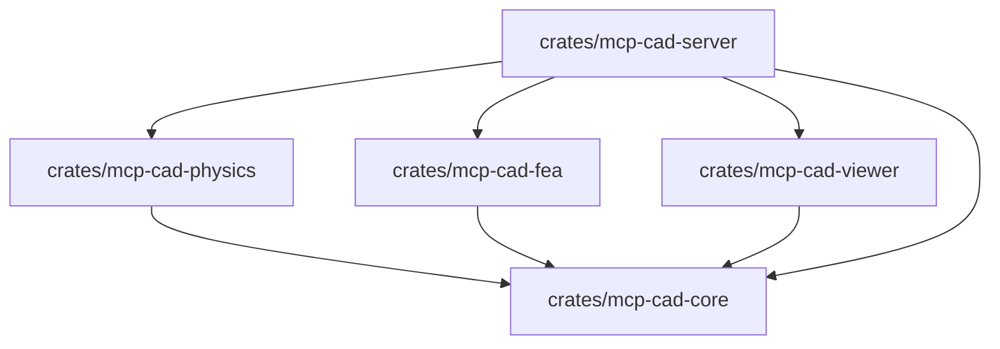

# PROJECT_CONTEXT: MCP-CAD Engine

> **Единый источник правды (Single Source of Truth) для инженеров и ИИ-агентов проекта.**  
> Любая разработка, рефакторинг, добавление инструментов и написание документации должны строго соответствовать архитектурным решениям, геометрическим инвариантам и контрактам, зафиксированным в этом документе.

---

## 1. Обзор проекта и Видение

**MCP-CAD Engine** — автономная инженерная 3D CAD/CAE система на языке **Rust**, спроектированная для управления искусственным интеллектом (LLM / AI Agents) через протокол **Model Context Protocol (MCP)** (`2024-11-05`, JSON-RPC 2.0).

Система реализует замкнутый верифицируемый цикл инженерного проектирования ИИ-агента:
$$\text{Требования (Requirements)} \longrightarrow \text{Проектирование (Solid DAG)} \longrightarrow \text{Топологический аудит (Mesh Validation)} \longrightarrow \text{Анализ прочности (FEA) и Кинематики (Rapier3D)} \longrightarrow \text{Визуальный контроль (WGPU) и Экспорт (STL / Project JSON)}$$

### Ключевые возможности
1. **Параметрическое твердотельное моделирование (Solid Modeling DAG & CBO)**: Дерево построения деталей (`FeatureTree`) с поддержкой 8 аналитических и машиностроительных примитивов (`box`, `cylinder`, `sphere`, `cone`, `polygon_prism`, `spur_gear`, `revolve`, `wheel_rim`), вырезов (`cut_hole` со шпоночным пазом и режимом `through: true`, `cut_helical_groove` со спиральным и резьбовым профилем ISO 68-1), булевых операций CSG (`union`, `difference`, `intersection`), пространственных трансформаций (`transform_part` с выравниванием по именованным граням), редактирования истории (`modify_feature`) и стоимостного оптимизатора запросов (**Cost-Based CAD Query Optimizer**, правила `R1`–`R5`).
2. **Топологическое именование граней (`FaceInfo`) и семантические селекторы (`FaceSelector`)**: Каждый треугольник сетки несёт идентификатор логической грани `face_id`, сохраняющийся при трансформациях и булевых операциях CSG. ИИ-агент обращается к поверхностям детали по смыслу (`"cap_top"`, `"cap_bottom"`, `"hole_wall:feat_1"`, `{"where": {"kind": "cylinder", "radius": 5.0}}`), а не по «сырым» координатам.
3. **Слой инженерных требований и самопроверки (`Requirements Layer`)**: Декларативное задание ограничений (`bbox_max`, `bbox_min`, `mass_max`, `mesh_valid`, `min_safety_factor`, `no_interference`, `mechanism_dof`) через `set_requirements` (`auto_check: true`) и проверка запасов через `check_requirements` с отслеживанием актуальности расчётов МКЭ по ревизии детали (`part.revision`).
4. **Линейный МКЭ-анализ прочности (FEA Linear Elasticity)**: Воксельная тетраэдризация (`TET4`, `element_order = 1`) и квадратичные 10-узловые изопараметрические тетраэдры (`TET10`, `element_order = 2`, 4-точечная квадратура Гаусса 2-го порядка, устраняющая `shear locking` при изгибе) с адаптивным измельчением поверхностных рёбер, сборка разреженной матрицы жёсткости ($K \cdot u = F$), решение методом сопряжённых градиентов (PCG), граничные условия Дирихле и Неймана (силы в `N`, давление в `MPa`, моменты в `N·m`) по именованным граням, расчёт напряжений по Мизесу ($\sigma_{vM}$) и коэффициента запаса прочности ($FoS = \sigma_y / \max \sigma_{vM}$).
5. **Кинематика и динамика механизмов (`Rapier3D`)**: Твёрдые тела с автоматическим пересчётом массы, центра масс и тензора инерции из полигональной сетки и плотности материала $\rho$; 5 типов сочленений (`Revolute`, `Prismatic`, `Spherical`, `Fixed`, `Gear`), приводы (`set_joint_motor`), статические якоря `"ground"` / `"world"`, телеметрия траекторий, пиковых реакций и коллизий.
6. **WGPU 3D Viewport & Headless Offscreen Render**: Оффскрин-рендеринг сцены и тепловых карт МКЭ в PNG/Base64 (`capture_viewport`, `get_fea_heatmap_image`), работающий на любой платформе (включая headless-контейнеры через программный Vulkan Lavapipe и CPU-fallback), а также нативное интерактивное 3D-окно (`winit` + `wgpu`, `open_preview_window`, `--gui`, `--stl`).
7. **Двойной транспорт MCP и персистентность**: Поддержка `stdio` (для локального запуска в Google Antigravity, Claude Desktop, Cursor) и `HTTP/SSE` (Axum), плюс транзакционное сохранение/загрузка проектов (`save_project` / `load_project`, `schema_version = "1.0.0"`).

---

## 2. Целевая платформа и технологический стек

- **Операционная система**: Windows 10/11 x64 (целевая десктопная платформа) и Linux x86_64 (облачная среда разработки, CI и контейнеры).
- **Язык и тулчейн**: **Rust `1.91`** (зафиксирован в `rust-toolchain.toml` и `Dockerfile` на базе `rust:1.91-bookworm`, Edition 2021) + TypeScript/React (Vite) для веб-интерфейса предпросмотра на порту `3000`.
- **Философия зависимостей**: **Pure Rust (Zero C++ dependency)**. Сборка не требует MSVC C++ SDK, CMake, Clang или внешних системных DLL. Все геометрические, топологические, конечно-элементные, физические и графические вычисления выполняются на чистом Rust.

---

## 3. Архитектура Cargo Workspace

Проект организован как Cargo Workspace из 5 модульных крейтов:

```text
mcp-cad/
├── Cargo.toml                    # Корневой манифест workspace
├── rust-toolchain.toml           # Фиксация компилятора Rust 1.91 (clippy, rustfmt)
├── PROJECT_CONTEXT.md            # Единый источник правды (архитектура и принятые решения)
├── TASKS.md                      # Актуальный бэклог задач и сводный реестр выполненных фаз
├── docs/
│   ├── AGENT_GUIDE.md            # Операционное руководство для ИИ-агента (<= 2 стр.)
│   ├── MCP_API_REFERENCE.md      # Полный справочник схем и примеров всех 34 MCP-инструментов
│   ├── UNITS.md                  # Аудит и спецификация контракта единиц измерения [DECISION-UNITS-1]
│   ├── FACE_NAMING_DESIGN.md     # Архитектура топологического именования граней [DECISION-FACES-1..4]
│   ├── FEA_ACCURACY.md           # Матрица базовой точности МКЭ на 4 аналитических эталонах (P3-T1, P3-T4)
│   ├── DECISIONS.md              # Архитектурные решения уровня сервера и транспорта (ADR-001..004)
│   ├── MIGRATION_TS_TO_RUST.md   # План консолидации TS-клиента вокруг единого Rust-бэкенда
│   ├── BENCH_BASELINE_RUST.md    # Базовая линия 15 задач бенчмарка против нативного Rust-сервера
│   ├── adr/0001-geometry-kernel.md # ADR выбора геометрического ядра (manifold-rust + monstertruck)
│   ├── adr/0002-fe-mesher.md        # ADR выбора генератора сетки МКЭ (fe_snap + TET10, P3-T5)
│   └── agent_tasks/              # Детальные отчёты о выполнении задач P0-T1..T12, P1-T1..T4, P2-T1..T40, P3-T1..T5
├── spikes/
│   ├── manifold_rust/            # Прототип ядра manifold-rust v0.19.2 (Pure Rust CSG + face_id)
│   ├── monstertruck_brep/        # Прототип B-Rep ядра monstertruck v0.4.1 (fillet + ISO 10303-21 STEP)
│   └── fe_snap/                  # Прототип boundary-conforming мешера (P3-T5: line-search + TET10)
└── crates/
    ├── mcp-cad-core/             # Геометрическое ядро, примитивы, CSG, DAG, CBO, топология, STL
    ├── mcp-cad-physics/          # Динамика и кинематика механизмов (Rapier3D), шарниры, моторы
    ├── mcp-cad-fea/              # Тетраэдризация (TET4/TET10), МКЭ-решатель PCG, Мизес, FoS, ГУ по граням
    ├── mcp-cad-viewer/           # Рендеринг WGPU/Winit, шейдеры, offscreen PNG/Base64 + CPU fallback
    └── mcp-cad-server/           # MCP-сервер (stdio/SSE), состояние сцены, диспетчер 34 инструментов
```

### Граф зависимостей между крейтами



---

## 4. Спецификация подсистем, систем координат и семантики DAG

### 4.1. Система координат примитивов и привязки (`crates/mcp-cad-core/src/primitives.rs`)

Во всём движке принята правая система координат с вертикальной осью **$Z$ ($Z$-up)** для всех тел вращения, призм, шестерён и резьбовых/винтовых элементов.

- **Локальный центр (`origin`)**: каждый примитив строится центрированным относительно локального начала координат $[0, 0, 0]$.
- **Порядок пространственной привязки (`position` и `rotation_deg`)**: если в `add_feature_primitive` (или `modify_feature`) переданы опциональные параметры `rotation_deg: [rx, ry, rz]` (углы Эйлера Roll-Pitch-Yaw в градусах) и `position: [px, py, pz]` (в активном `length_unit`), сетка примитива сначала поворачивается вокруг $[0, 0, 0]$, а затем переносится на вектор `position`.

#### Сводная таблица привязок, осей и канонических граней всех 8 примитивов

| `primitive_type` | Обязательные и ключевые параметры | Ориентация оси и положение `origin` $[0,0,0]$ | Диапазон локальных координат ($X, Y, Z$) | Канонические имена граней (`role` / `aliases`) |
|---|---|---|---|---|
| **`box`** | `width` ($w$), `height` ($h$), `depth` ($d$) | Центрирован в $[0,0,0]$: `width` вдоль $X$, `height` вдоль $Y$, `depth` вдоль $Z$ | $X \in [-w/2, +w/2]$<br>$Y \in [-h/2, +h/2]$<br>$Z \in [-d/2, +d/2]$ | `top` (`+Z`, алиасы `cap_top`, `max_z`), `bottom` (`-Z`, `cap_bottom`, `min_z`), `right` (`+X`, `max_x`), `left` (`-X`, `min_x`), `back` (`+Y`, `max_y`), `front` (`-Y`, `min_y`) |
| **`cylinder`** | `radius` ($r$), `height` ($h$), `segments?` | Ось вращения вдоль **$Z$**, центр на середине высоты $[0,0,0]$ | $X, Y \in [-r, +r]$<br>$Z \in [-h/2, +h/2]$ | `cap_top` (`+Z`, `top`, `max_z`), `cap_bottom` (`-Z`, `bottom`, `min_z`), `side` (цилиндрическая стенка) |
| **`cone`** | `radius_bottom` ($r_{\text{bot}}$), `radius_top?` ($r_{\text{top}}$, `0` = острый конус), `height` ($h$), `segments?` | Ось вдоль **$Z$**, центр высоты в $[0,0,0]$. **Основание `radius_bottom` лежит на $Z = -h/2$, вершина / верхний торец `radius_top` — на $Z = +h/2$** | $X, Y \in [-r_{\max}, +r_{\max}]$<br>$Z \in [-h/2, +h/2]$ | `cap_bottom` ($Z=-h/2$, если $r_{\text{bot}}>0$), `cap_top` ($Z=+h/2$, если $r_{\text{top}}>0$), `side` (коническая боковая поверхность) |
| **`sphere`** | `radius` ($r$), `sectors?`, `stacks?` | Центр сферы в $[0,0,0]$, полюса на оси $Z$ ($\pm r$) | $X, Y, Z \in [-r, +r]$ | `surface` (алиасы `sphere_surface`, `side`) |
| **`polygon_prism`** | `height` ($h$), `sides?` ($n \ge 3$, по умолч. `6`), `width_across_flats?` ($S$) или `radius`/`outer_radius` ($R$), `chamfer`/`chamfer_radius?` | Ось призмы вдоль **$Z$**, центрирована в $[0,0,0]$. Для правильного $n$-угольника $R = \frac{S}{2\cos(\pi/n)}$. Конические фаски 30° по DIN 934 снимаются на обоих торцах $Z = \pm h/2$ | $X, Y \in [-R, +R]$<br>$Z \in [-h/2, +h/2]$ | `cap_top` (`+Z`), `cap_bottom` (`-Z`), `side_0..side_{n-1}` (грани под ключ), при фаске: `chamfer_top_0..{n-1}`, `chamfer_bottom_0..{n-1}` |
| **`spur_gear`** | `module` ($m$), `teeth` ($z$), `face_width` ($b$), `pressure_angle_deg?` ($20^\circ$), `bore_radius`/`bore_diameter?`, `keyway_width?`, `keyway_depth?`, `hub_diameter?`, `hub_length?` | Ось шестерни вдоль **$Z$**. Зубчатый венец центрирован в $Z \in [-b/2, +b/2]$. Делительный диаметр $d_p = m \cdot z$. При наличии ступицы (`hub_length` $L_{\text{hub}}$) она выступает в сторону $+Z$ до $Z = +b/2 + L_{\text{hub}}$; шпоночный паз ориентирован по $+X$ | $X, Y \in [-r_a, +r_a]$<br>$Z \in [-b/2, +b/2 + L_{\text{hub}}]$ | Эвольвентный профиль по DIN 867 / ISO 53 и шпоночный паз по DIN 6885 |
| **`revolve`** | `profile`: `[[r0, z0], [r1, z1], ...]` ($r \ge 0$), `inner_radius?`, `angle_deg?` ($360^\circ$), `segments?` | Вращение 2D-контура $(r, z)$ вокруг оси **$Z$** (при `angle_deg < 360°` от $+X$ к $+Y$ с плоскими торцевыми крышками). При 2-точечном профиле и `inner_radius` автоматически замыкается в кольцевой 4-угольник | $X, Y \in [-r_{\max}, +r_{\max}]$<br>$Z \in [z_{\min}, z_{\max}]$ (как задано в `profile`) | Поверхность тела вращения |
| **`wheel_rim`** | `rim_diameter` ($D$), `rim_width` ($W$), `flange_diameter?`, `hub_diameter?`, `hub_bore_diameter?`, `pcd_diameter?`, `bolt_holes_count?`, `bolt_hole_diameter?`, `spokes_count?`, `offset_et?` | Ось вращения диска вдоль **$Z$**, обод центрирован в $[0,0,0]$ | $X, Y \in [-D_{\text{flange}}/2, +D_{\text{flange}}/2]$<br>$Z \in [-W/2, +W/2]$ | Ступенчатый профиль обода ISO/ETRTO, центральное отверстие, разболтовка PCD и спицы |

---

### 4.2. Семантика параметрического дерева `FeatureTree` (Solid DAG, `crates/mcp-cad-core/src/dag.rs`)

Дерево операций детали (`Part::dag`) представляет собой упорядоченный список узлов `FeatureNode` (`id: Uuid`, `name: String`, `enabled: bool`, `op: FeatureOp`), вычисляемый последовательно методом `FeatureTree::evaluate_with_settings(settings)`:

1. **Автоматическое булево объединение последовательных примитивов (`Add*`)**:
   - **Первый активный примитив** (`node_idx == 0`: `AddBox`, `AddCylinder`, `AddCone`, `AddSphere`, `AddPolygonPrism`, `AddSpurGear`, `AddRevolve`, `AddWheelRim`, `ImportedMesh`) инициализирует твердотельную сетку детали `current_mesh = Some(prim_mesh)`.
   - **Каждый следующий вызов `add_feature_primitive` на том же `part_id`** (`node_idx >= 1`) **НЕ перезаписывает** деталь, а автоматически объединяется с текущей геометрией детали через булево сложение:
     $$\text{current\_mesh} \longleftarrow \text{csg\_union}(\text{current\_mesh}, \text{new\_primitive\_mesh})$$
   - Если требуется создать **отдельное независимое тело** (например, второе звено механизма или деталь-инструмент для `boolean_difference` / `boolean_intersection`), необходимо сначала вызвать `create_part`.
2. **Субтрактивные конструктивные элементы (`CutHole` и `CutHelicalGroove`)**:
   - `cut_hole` вычитает из текущего тела детали цилиндрический резец (с опциональной призмой шпоночного паза DIN 6885) вдоль вектора `normal`/`direction`. При `"through": true` глубина сверления и точка входа автоматически рассчитываются по проекции габаритов текущей сетки детали вдоль оси отверстия с гарантированным вылетом наружу. Выжившая стенка отверстия получает каноническую грань `hole_wall:feat_k` (алиас `"hole_wall"`).
   - `cut_helical_groove` строит кинематическую винтовую фрезу (`profile_type: "circular"` для стружечных канавок свёрл или `"metric_60"` для метрической резьбы 60° по ISO 68-1) и вычитает её через `csg_difference`. Если параметр `start_z` не передан, начало спирали **автоматически выравнивается по нижней грани детали** `part.bounding_box().min[2]` (поэтому для детали высотой $h$, центрированной в $[-h/2, +h/2]$, спираль длиной `height = h` покрывает всю высоту детали без ручного расчёта `start_z = -h/2`).
3. **Меш-булевы операции и трансформации в DAG**:
   - `boolean_difference`, `boolean_union`, `boolean_intersection` сохраняют снимок сетки детали-инструмента (`tool_part_id`) в узле `FeatureOp::Boolean*Mesh { tool_mesh }` целевой детали `target_part_id`.
   - `transform_part` добавляет узел `FeatureOp::Transform { translation, rotation_deg, scale }` (включая вычисление сдвига при вращении вокруг `pivot_face` или совмещении `align_face` с `target_point`).
   - Для деталей, загруженных из `.stl` через `import_stl`, метод `Part::ensure_imported_mesh_in_dag()` автоматически оборачивает исходную сетку в корневой узел `FeatureOp::ImportedMesh { mesh }`, обеспечивая работу `transform_part`, `cut_hole`, `cut_helical_groove` и `boolean_*` без ошибки пустого дерева.

---

### 4.3. Спецификация остальных подсистем

#### `crates/mcp-cad-physics` (Динамика и кинематика механизмов)
- Интеграция с `rapier3d`: автоматическое построение твёрдых тел (`RigidBodyType::Dynamic` при `!part.is_fixed` и `RigidBodyType::Fixed` при `part.is_fixed == true`) и коллайдеров (`Collider`), расчёт массы и тензора инерции по объёму сетки и плотности материала $\rho$.
- Статические мировые якоря `"ground"` и `"world"` (регистронезависимые, защищены от удаления и переопределения в `create_part` / `delete_part`).
- 5 типов шарниров (`CadJointType`): `Revolute` (ось, пределы углов `limits` в `deg`, мотор угловой скорости `rad/s` и момента `N·m`), `Prismatic` (ось, пределы хода `limits` в `mm`/`m`, мотор линейной скорости `m/s` и силы `N`), `Spherical`, `Fixed`, `Gear` (кинематическая зубчатая передача с отношением `ratio` или `teeth_a / teeth_b` и осями `axis_a`, `axis_b`).

#### `crates/mcp-cad-fea` (Конечно-элементный анализ прочности)
- Генератор тетраэдральной сетки `TetrahedralMesh` (`TET4` и конвертация `to_tet10()` в квадратичные 10-узловые изопараметрические тетраэдры `TET10` без дублирования mid-edge узлов, `P3-T4`) с обязательной предполётной проверкой топологии `mcp_cad_core::validate_mesh` (отклоняющей незамкнутые или неманифольдные сетки с кодом `MESH_INVALID` / `FeaError::InvalidSurfaceMesh`), предварительным измельчением длинных поверхностных треугольников (`refine_mesh_max_edge_length`) и сохранением `face_ids`.
- Сборка глобальной разреженной матрицы жёсткости $K$ (CSR, $12\times 12$ для `TET4` и $30\times 30$ с 4-точечной квадратурой Гаусса 2-го порядка для `TET10`) по 3D закону Гука и решение СЛАУ $K \cdot u = F$ предобусловленным методом сопряжённых градиентов (PCG).
- Граничные условия (`BoundaryConditions`): закрепления Дирихле (`fixed` по `FaceSelector`, `fixed_faces`, `fixed_plane`) и нагрузки Неймана (`loads` по `FaceSelector`: суммарная сила `force` в `N`, нормальное давление `pressure` в `MPa`, крутящий/изгибающий момент `moment` в `N·m`, либо точечные `applied_forces`; для `TET10` используются согласованные квадратичные веса 6-узловых поверхностных треугольников).
- Пострешение и диагностика достоверности (`FeaDiagnostics`, `P3-T2`, `P3-T3`, `P3-T4`): экстраполяция напряжений из 4 точек Гаусса в 10 узлов элемента `TET10`, вычисление узловых реакций опор $\mathbf{R} = K\mathbf{u} - \mathbf{f}$ (`compute_nodal_reactions` / `compute_nodal_reactions_tet10`), проверка баланса сил (`equilibrium_error_pct`) и моментов относительно ЦМ, контроль полноты закрепления 6 мод жёсткого тела (`constrained_rigid_body_modes_ok`), выделение 1-элементной зоны сингулярности заделки (`critical_node_near_constraint`, `max_stress_excluding_constraint_zone`), статистика качества тетраэдров Лю–Джо (`element_quality: {min, mean}`), исследование сеточной сходимости и экстраполяция Ричардсона (`accuracy`) и оценка уровня доверия `confidence: "high" | "medium" | "low"`.

#### `crates/mcp-cad-viewer` (WGPU & Offscreen Render)
- Оффскрин-рендерер `OffscreenRenderer` (`capture_viewport`, `get_fea_heatmap_image`): рендерит полигональную сетку или цветовую карту напряжений МКЭ (`jet_engineering`) с выбранного ракурса (`Isometric`, `Top`, `Front`, `Right`, `Back`, `Bottom`, `Left`) и в режимах отладки (`Shaded`, `Wireframe`, `Normals`, `Backfaces`, `BoundaryEdges`) в PNG/Base64. Имеет автоматический программный fallback, если аппаратный GPU недоступен.
- Интерактивное окно `winit` + `wgpu` (`window.rs`): запускается при передаче `--gui`, `--standalone`, `--stl <path>` или по вызову `open_preview_window`.

---

## 5. Принятые архитектурные и инженерные решения (Decisions & Rationale)

В этом разделе собраны все фундаментальные решения, принятые и реализованные в ходе фаз **P0 (Foundation)**, **P1 (Architecture)** и **P2 (Agent ↔ System Contract)**, с подробным объяснением причин их выбора.

---

### 5.1. `[DECISION-UNITS-1]` Контракт единиц измерения: миллиметры (`mm`) на границе MCP, строгое СИ внутри ядра
- **Связанные документы и задачи**: [`docs/UNITS.md`](docs/UNITS.md), `P2-T1`, `P2-T2`, `P2-T26`, `P2-T27`, `P2-T29`, `P2-T30`, `P2-T32`, `P2-T34`, `P2-T36`.
- **Почему принято**:
  1. ИИ-агенты (LLM) и инженеры-машиностроители по умолчанию мыслят в **миллиметрах** (`width: 100`, `radius: 5`, `module: 2`, шаг резьбы `pitch: 1.5`). Когда ранний API ожидал метры (`m`) на входе, но возвращал прогибы МКЭ в `mm` и напряжения в `MPa`, любая передача `100` (вместо `0.1`) приводила к катастрофической ошибке масштаба: линейные размеры завышались в $10^3$ раз, площадь — в $10^6$ раз, объём и масса — в $10^9$ раз (кронштейн весил 392 тонны), а изгибные напряжения в МКЭ занижались в $10^6$ раз.
  2. В то же время внутри численных решателей (`mcp-cad-core`, `mcp-cad-fea`, `mcp-cad-physics`) переписывать уравнения упругости, плотности и динамики под миллиметры опасно из-за несогласованности производных единиц СИ ($\text{Па} = \text{Н}/\text{м}^2$, $\text{кг}/\text{м}^3$, $g = 9.81\text{ м/с}^2$) и калибровки допусков тесселяции/сварки вершин.
- **Что именно реализовано**:
  - **На границе MCP API (`crates/mcp-cad-server/src/tools/*.rs`)**: по умолчанию `EngineState::length_unit = LengthUnit::Mm` (`"mm"`). Все линейные входы и выходы (`width`, `height`, `depth`, `radius`, `module`, `pitch`, `position`, `translation`, `bounding_box`, `dimensions`, `center_of_mass`, `anchor_a`/`anchor_b`, `chord_tolerance`, радиусы и центроиды граней, а также узлы планов `optimize_feature_tree` и вершины меш-операндов в `get_feature_tree`) принимаются и возвращаются в `mm`, площади — в `mm²`, объёмы — в `mm³`, ускорение свободного падения `gravity` в `get_simulation_metrics_json` — в `mm/s²` с точной `f64`-разрядностью (с дублированием эталонных СИ-полей `volume_m3`, `surface_area_m2`, `mass_kg`, `gravity_m_s2`).
  - **Фиксированные инженерные единицы**: сила — `N`, момент — `N·m`, напряжение и давление — `MPa`, модуль Юнга — `GPa`, перемещение МКЭ — `mm`, масса — `kg`, плотность — `kg/m³`, углы в CAD и пределах `limits` вращательных шарниров — `deg`, угловая скорость — `rad/s`, время — `s` (`step_size_ms` — `ms`).
  - **Переключение и локальное переопределение**: инструмент №29 `set_units({"length_unit": "mm" | "m"})` меняет единицу сессии, а любой инструмент принимает опциональный аргумент `"length_unit": "mm" | "m"` для одиночного вызова (`state.resolve_length_unit(args)`), который также пробрасывается в `attach_auto_check_if_enabled` (`P2-T30`).
  - **Формат `.stl` на диске**: координаты вершин внутри файлов `.stl` (`export_stl`, `import_stl`) хранятся во внутренних единицах ядра — **метрах СИ (`m`)** (`"stl_vertex_unit": "m"`), чтобы избежать двойного масштабирования при round-trip экспорте/импорте между подсистемами.
  - **Эвристический контроль масштаба (`check_scale_sanity`)**: мутирующие инструменты возвращают массив `warnings: []`, предупреждающий агента при подозрительных размерах (`SCALE_TOO_LARGE` при габарите $> 10\text{ м}$, `SCALE_TOO_SMALL` при $< 0.1\text{ мм}$, `SCALE_EXTREME_VOLUME`, `WHEEL_RIM_SCALE` при диаметре диска $< 150\text{ мм}`).

---

### 5.2. `[DECISION-FACES-1..4]` Топологическое именование граней (`face_ids` / `FaceInfo`) и семантические селекторы `FaceSelector`
- **Связанные документы и задачи**: [`docs/FACE_NAMING_DESIGN.md`](docs/FACE_NAMING_DESIGN.md), `P2-T5`, `P2-T6`, `P2-T7`, `P2-T8`, `P2-T14`.
- **Почему принято**:
  1. У LLM-агентов отсутствует пространственное зрение: требовать от агента вычислять мировые координаты узлов для приложения силы МКЭ или угадывать, какая грань повернутой детали соответствует `min_x` / `max_z`, приводило к ошибкам закрепления и промахам мимо поверхности детали.
  2. Эвристический детектор `inspect_geometry` (`detected_planar_faces`) видел только плоские кластеры, не распознавал цилиндрические отверстия (`Cylinder`), конусы (`Cone`) и винтовые канавки (`Helical`), а для кольцевого торца втулки возвращал центроид `[0, 0, z]` в пустоте центрального отверстия.
- **Что именно реализовано**:
  - В `TriangleMesh` (`topology.rs`) добавлены параллельный массив `face_ids: Vec<u32>` (по одному ID на треугольник, `#[serde(default, skip_serializing_if = "Vec::is_empty")]`) и реестр `faces: Vec<FaceInfo>` с полями `id`, `name`, `aliases`, `role`, `kind` (`Plane`, `Cylinder`, `Cone`, `Sphere`, `Torus`, `Helical`, `Other`), `origin_feature`, `area`, `centroid`, `sample_point` (точка, гарантированно лежащая на металле грани, а не в пустоте отверстия!), `normal_or_axis`, `radius`, `triangles_count`.
  - **Двухуровневая схема имён**: базовый примитив (`node_idx == 0`) получает короткие имена (`"top"`, `"bottom"`, `"cap_top"`, `"cap_bottom"`, `"side"`, `"left"`, `"right"`, `"front"`, `"back"`) и квалифицированные алиасы (`"feat_0:cap_top"`, `"<uuid>:cap_top"`). Вырезы (`cut_hole`, `cut_helical_groove`, `boolean_difference`) маркируют новые внутренние поверхности как `"hole_wall:feat_k"` (с коротким алиасом `"hole_wall"`, если отверстие одно) и `"cut:feat_k:<role>"`.
  - **Сохранение сквозь CSG и постобработку (`csg.rs`)**: `CsgPolygon` хранит `face_id`; в `BspNode::polygons_from_mesh` слияние соседних треугольников в квад, в `optimize_coplanar_delaunay_edges` перевороты рёбер и в `smooth_coplanar_interior_vertices` сглаживание **строго запрещены через границу разных `face_id`**, благодаря чему границы конструктивных граней остаются геометрически точными.
  - **Проекционная привязка МКЭ (`crates/mcp-cad-fea/src/boundary.rs`)**: поскольку воксельная сетка `TET4` имеет ступенчатую границу, метод `match_surface_nodes_and_weights` проецирует внешние узлы тетра-сетки на треугольники выбранной CAD-грани (`point_to_triangle_distance_3d` в пределах шага сетки) и распределяет узловые силы пропорционально грузовой площади, сохраняя главный вектор силы с относительной точностью $< 10^{-9}$.

---

### 5.3. `[DECISION-ERRORS]` Двухуровневый контракт ошибок MCP и структурированный `ErrorEnvelope`
- **Связанные документы и задачи**: [`docs/MCP_API_REFERENCE.md`](docs/MCP_API_REFERENCE.md), `P0-T4`, `P2-T3`, `P2-T11`, `P2-T16`, `P2-T22`, `P2-T23`.
- **Почему принято**:
  1. По спецификации MCP `2024-11-05` возврат протокольной ошибки JSON-RPC (`error: {code: -32602}`) при ошибке бизнес-логики инструмента заставляет некоторые MCP-клиенты (Claude Desktop, Antigravity) считать сам канал связи неисправным или скрывать тело ответа от LLM.
  2. Простая текстовая строка ошибки не давала агенту однозначного указания, какой именно аргумент невалиден и какие идентификаторы (`part_id`, `face`, `primitive_type`) реально доступны в текущей сессии.
- **Что именно реализовано**:
  - Верхнеуровневое поле JSON-RPC `"error"` (`-32700`..`-32603`) используется **только** для синтаксических и протокольных нарушений JSON-RPC до вызова диспетчера инструментов.
  - Все ошибки выполнения инструментов (`ServerError`) возвращаются в успешном JSON-RPC конверте с флагом **`result.isError = true`** и JSON-строкой `ErrorEnvelope` в `result.content[0].text`:
    ```json
    {
      "error": {
        "code": "PART_NOT_FOUND",
        "message": "Part not found: shaft_pin",
        "param": "part_id",
        "hint": "Part 'shaft_pin' was not found. Available parts: [part-1]. Inspect parts via 'list_parts' or create it with 'create_part'.",
        "retryable": false,
        "details": { "part_id": "shaft_pin", "available_parts": ["part-1"] }
      }
    }
    ```
  - Внедрено **36 стабильных машиночитаемых кодов** (`PART_NOT_FOUND`, `FEATURE_NOT_FOUND`, `JOINT_NOT_FOUND`, `FACE_NOT_FOUND`, `AMBIGUOUS_FACE_SELECTOR`, `INVALID_ARGUMENT`, `FEA_UNCONSTRAINED`, `FEA_NO_LOADS`, `PROJECT_SCHEMA_MISMATCH` и др.) с автоматическим заполнением списка существующих деталей (`available_parts`), граней (`available_faces`) и пресетов материалов (`builtin_materials`).

---

### 5.4. `[DECISION-REQUIREMENTS-REVISION]` Слой инженерных требований, счётчик ревизий `Part::revision` и защита от ложного `STALE`
- **Связанные задачи**: `P2-T9`, `P2-T24`, `P2-T27`, `P2-T30`.
- **Почему принято**:
  1. ИИ-агенты склонны пропускать ручную перепроверку массы, габаритов и запаса прочности после модификации параметров детали. Декларативный инструмент `set_requirements` с флагом `auto_check: true` перекладывает контроль инвариантов на сам сервер: каждый мутирующий вызов автоматически дописывает `requirements_status: {passed, failed, stale}` в свой JSON-ответ.
  2. Автоматически перезапускать 3D МКЭ (`run_fea_analysis`) после каждого чиха в DAG нельзя из-за высокой вычислительной стоимости (сотни миллисекунд — секунды). Вместо этого в `Part` введён монотонный счётчик `revision: u64`, а в `EngineState` сохраняется ревизия детали на момент последнего расчёта МКЭ (`last_fea_revisions`). Если геометрия детали изменилась (`part.revision != fea_revision`), требование `min_safety_factor` и сводка `get_scene_summary.last_fea` мгновенно переходят в статус **`STALE`**, сигнализируя агенту о необходимости перезапустить `run_fea_analysis`.
  3. **Защита от ложного устаревания (`P2-T24`, `P2-T27`)**: обнаружено, что смена разрешения триангуляции в `export_stl` (который по умолчанию рендерит сетку с качеством `"fine"`) или `tessellate_part`, а также вызов `optimize_feature_tree(apply: true)`, когда ни одно правило оптимизации не сработало (`applied_rules.is_empty()`), не меняют параметрическую геометрию детали. Поэтому `Part::tessellate` и холостой `Part::optimize_dag` **не инкрементируют `part.revision`**, сохраняя результаты МКЭ в актуальном статусе `FRESH` / `PASS`.

---

### 5.5. `[DECISION-TRANSACTIONAL-STATE]` Атомарная транзакционность мутаций, сохранение шарниров при редактировании геометрии и персистентность
- **Связанные задачи**: `P0-T11`, `P2-T4`, `P2-T12`, `P2-T15`, `P2-T17`, `P2-T18`, `P2-T19`, `P2-T23`, `P2-T33`.
- **Почему принято и что реализовано**:
  1. **Полный транзакционный откат при ошибках (`P2-T12`, `P2-T17`, `P2-T19`, `P2-T24`)**:
     - В `batch_cad_operations` при сбое любого шага состояние сцены откатывается целиком, включая клонированный физический мир `state.physics_world.clone()` (`PhysicsWorld: Clone`).
     - В `modify_feature`, `optimize_feature_tree`, `tessellate_part` и `export_stl` перед пересборкой сохраняется снимок `(dag, mesh, cached_mesh, cached_settings, revision)`: если `rebuild()` или валидация параметров завершается ошибкой, деталь остаётся в 100% консистентном предыдущем состоянии.
     - В `PhysicsWorld::set_joint_motor` запись `record.motor` обновляется строго после успешного применения мотора к шарниру Rapier3D (`apply_motor`), а установка мотора на `CadJointType::Gear`, `Fixed` и `Spherical` отклоняется с `INVALID_JOINT_CONFIGURATION`.
  2. **Обновление коллайдеров на месте без потери шарниров (`PhysicsWorld::update_part_collider`, `P2-T18`)**:
     - Ранее при выполнении `boolean_*`, `transform_part` или `optimize_feature_tree` деталь перерегистрировалась в физическом мире через `remove_part` + `add_part`, что побочным эффектом уничтожало все привязанные к ней шарниры (`joints`) и зубчатые передачи (`gear_constraints`), а при вызове `add_feature_primitive` / `cut_hole` / `modify_feature` коллайдер в `physics_world` вообще не обновлялся.
     - Реализован метод `PhysicsWorld::update_part_collider(&mut self, part: &Part)`, который пересоздаёт `Collider` и пересчитывает массу и тензор инерции непосредственно на существующем `RigidBodyHandle`, сохраняя все шарниры, приводы и флаг неподвижности `!part.is_fixed`.
  3. **Персистентность без раздувания файлов (`save_project` / `load_project`, `P2-T4`)**:
     - Файл проекта (`schema_version = "1.0.0"`) сохраняет единицы измерения, кастомные материалы, параметрические деревья `FeatureTree` деталей, требования и шарниры с моторами, но **не сериализует полигональные сетки процедурных деталей** (`mesh` восстанавливается детерминированно через `part.rebuild()` при `load_project`). Исключение сделано только для импортированных STL-деталей через узел `FeatureOp::ImportedMesh` (`P2-T33`).

---

### 5.6. `[DECISION-MESH-QUALITY-CBO]` Геометрические инварианты примитивов, двухфазная постобработка CSG и барьерные правила CBO (`R1`–`R5`)
- **Связанные задачи**: `P0-T1`..`P0-T10`, `P2-T15`, `P2-T20`, `P2-T23`, `P2-T25`, `P2-T28`, `P2-T31`.
- **Почему принято и что реализовано**:
  1. **Ориентация крышек и избавление от игольчатых треугольников (`Sliver Triangles`, `< 1°` и `< 5°`)**:
     - Исправлен обход колец в `add_bridged_ring_strip_2d` и `add_halving_ring_transition_2d` (`P0-T1`), гарантирующий внешние нормали ($\mathbf{n}\cdot(\pm\mathbf{Z}) > 0$) и положительный объём `signed_volume() > 0`.
     - Внедрено конформное геометрическое разрежение колец 2-к-1 (и 3-к-1 для нечётного числа сегментов) к полюсам конусов (`create_cone`), торцевым крышкам неполных тел вращения (`create_revolve` с точками Штейнера Бойера–Уотсона и флипами Делоне) и коническим фаскам многогранных призм (`create_polygon_prism`), а также точная радиальная проекция O-grid вокруг болтовых отверстий и пропорциональное масштабирование зазоров `safe_clamp` для малых колёсных дисков (`create_wheel_rim`, `P0-T5`, `P0-T6`, `P0-T10`, `P2-T15`, `P2-T23`).
  2. **Двухфазная постобработка BSP-CSG (`crates/mcp-cad-core/src/csg.rs`, `P0-T7`)**:
     - Классическое разбиение полигонов плоскостями BSP порождает избыточные коллинеарные вершины и узкие клинья на касательных пересечениях (например, `cut_hole`). Реализован конвейер `optimize_csg_mesh_quality` (слияние копланарных треугольников одной грани в выпуклые квады до клиппинга, коалесценция нетронутых поддеревьев, удаление избыточных вершин на рёбрах через 1-ring ear-clipping и Link-Condition edge collapse, вставка точек Штейнера в вееры к дугам отверстий и флипы Делоне), обеспечивающий выполнение тождеств объёма $V(A \cup B) + V(A \cap B) = V(A) + V(B)$ с точностью $< 1\%$ и `t_junctions_count == 0`.
  3. **Корректность правил перезаписи Cost-Based Query Optimizer (`crates/mcp-cad-core/src/query_optimizer.rs`, `P0-T9`, `P2-T20`, `P2-T25`, `P2-T28`, `P2-T31`)**:
     - В правилах `R1` (свёртка трансформаций и проталкивание сдвига в корневой примитив, включая `AddSpurGear` и `AddWheelRim`), `R2` (отсечение непересекающихся по AABB вырезов и дубликатов отверстий), `R3` (пакетная группировка вычитаний по Де Моргану), `R4` (замена соосного цилиндра и сквозного отверстия на однопроходный кольцевой `AddRevolve`) и `R5` (слияние шестигранной призмы, отверстия и резьбы) введено понятие **барьерных узлов (`Transform`, аддитивных `Add*`, `BooleanUnionMesh`, `BooleanIntersectionMesh`)**: оптимизатор никогда не переносит и не группирует вычитания (`CutHole`) через промежуточную трансформацию или добавленную бобышку.
     - Оценка `estimate_primitive_aabb` учитывает точный описанный радиус $N$-угольника $R = \frac{w}{2\cos(\pi/\text{sides})}$, габариты шестерён/ободов со ступицами и матрицу поворота Эйлера `rotation_deg`.
     - Любой физический план принимается только после верификации: `validate_mesh == PASS`, сохранение рода поверхности `genus_before == genus_after` и расхождение объёма $\Delta V / V \le 1\%$.

---

### 5.7. `[DECISION-KERNEL-ADR0001]` Выбор целевого геометрического ядра и консолидация архитектуры `TS -> Rust`
- **Связанные документы и задачи**: [`docs/adr/0001-geometry-kernel.md`](docs/adr/0001-geometry-kernel.md), [`docs/MIGRATION_TS_TO_RUST.md`](docs/MIGRATION_TS_TO_RUST.md), [`docs/BENCH_BASELINE_RUST.md`](docs/BENCH_BASELINE_RUST.md), [`agent_prompts/P1_kernel_migration.md`](agent_prompts/P1_kernel_migration.md), `P1-T1`..`P1-T4`.
- **Почему принято**:
  1. На сложных многошаговых пересечениях криволинейных сеток (например, внутренняя метрическая резьба гайки М10 `cut_helical_groove` в `T08_hex_nut_m10` или цепочка `union + difference` на фланцевой втулке) текущий BSP-CSG (`csg.rs`) чувствителен к почти копланарным граням и может оставлять открытые граничные рёбра (`open_boundary_edges > 0`) при времени выполнения ~940 мс.
  2. Экспериментальная проверка 4 кандидатов в изолированных спайках (`spikes/manifold_rust` и `spikes/monstertruck_brep`) доказала:
     - **`manifold-rust v0.19.2` (Pure Rust порт Manifold, `Apache-2.0`)** работает в **37–188 раз быстрее** текущего BSP-CSG (`5–25 мс` против `940 мс`), математически гарантирует замкнутое 2-многообразие (`open_edges = 0`, `is_watertight = true` как на фланцевой втулке, так и на резьбе гайки М10 `T08` за `18.87 мс`) и нативно переносит `MeshGLP::face_id` с погрешностью площади граней `0.0000%`.
     - **`monstertruck v0.4.1` (Pure Rust B-Rep)** отлично подходит для аналитического экспорта в стандарт **ISO 10303-21 STEP** (`monstertruck-step`, `1.25 мс`), но его триангулятор `monstertruck-meshing` сбрасывает `FaceID` и генерирует 11.7% игольчатых треугольников.
  3. Поэтому утверждена **гибридная Pure-Rust стратегия**: `manifold-rust v0.19.2` как основное ядро булевых операций и сквозного переноса `face_ids` (пакет задач `P1-K1..P1-K5` в `agent_prompts/P1_kernel_migration.md`) + опциональный `monstertruck-step` (`P1-K6`) для экспорта аналитического дерева в формат STEP.

---

### 5.8. `[DECISION-AGENT-UX]` Самодостаточность контекста ИИ-агента в Antigravity / Claude Desktop (по итогам ревью работы агента)
- **Контекст (проблема из практики)**: При подключении `mcp-cad-server` в Google Antigravity внешний ИИ-агент тратил шаги на чтение исходных файлов проекта (`primitives.rs`, `dag.rs`, `main.rs`) по трём причинам и сталкивался с двумя блокерами:
  1. **Причина 1 (`primitives.rs`)**: В кратких инструкциях не было таблицы координатных привязок примитивов (где $Z=0$, центрированы ли цилиндр и конус в $[-h/2, +h/2]$, где основание `radius_bottom` и вершина `radius_top` конуса).
  2. **Причина 2 (`dag.rs`)**: Не было явно сказано, что последовательные вызовы `add_feature_primitive` на одной детали автоматически объединяются через `csg_union`, а не перезаписывают друг друга.
  3. **Причина 3 и Блокер 1 (`main.rs` / `open_preview_window`)**: При стандартном запуске MCP по `stdio` без флага `--gui` вызов `open_preview_window` возвращал отказ `"status": "headless"`, вынуждая агента искать в `main.rs` обходной CLI-флаг `--stl <path>`.
  4. **Блокер 2 (`validate_mesh` на сверле `cut_helical_groove`)**: Строгий порог `Sliver quality gate` (`min_angle < 1°` или `> 1%` треугольников `< 5°`) помечал полностью водонепроницаемую производственную геометрию спирального сверла как `status: "FAIL"`, блокируя конвейер агента.
- **Принятое решение**:
  1. Зафиксировать полную таблицу систем координат примитивов и семантику `FeatureTree` (авто-`csg_union` для `add_feature_primitive`, авто-`csg_difference` для `cut_hole` и `cut_helical_groove`) непосредственно в `PROJECT_CONTEXT.md` (разделы 4.1–4.2), `docs/AGENT_GUIDE.md`, `initialize.instructions` (`protocol.rs`) и в задачах `P2-T37..P2-T39` в `TASKS.md`.
  2. Реализовать в `open_preview_window` (`P2-T37`) автоматический экспорт временного STL и порождение фонового GUI-процесса `mcp-cad-server --stl <path>` при вызове из headless `stdio`-сессии.
  3. Разделить в `validate_mesh` (`P2-T38`) фатальные нарушения топологии тела (`FAIL`: дыры, не-многообразие, самопересечения, вырожденный объём) и предупреждения об узких треугольниках на острых кромках винтовых канавок (`WARN` при `is_watertight == true` и `self_intersections == 0`).

---

## 6. Внешние зависимости и совместимые версии

| Crate | Версия | Область применения |
|---|---|---|
| `nalgebra` | `^0.33` | Линейная алгебра, векторы, матрицы вращения Эйлера, МКЭ-расчёты |
| `rapier3d` | `^0.22` | Pure-Rust физический движок твёрдых тел, коллайдеров и шарниров |
| `wgpu` | `^22.0` | Кроссплатформенный графический API (DX12 / Vulkan / Lavapipe) |
| `winit` | `^0.30` | Нативное окно предпросмотра 3D-сцены и цикл событий |
| `tokio` | `^1.40` | Асинхронный рантайм (`features = ["full"]`) |
| `axum` | `^0.7` | HTTP/SSE сервер для сетевого режима MCP |
| `serde` / `serde_json` | `^1.0` | Сериализация JSON-RPC 2.0, деревьев DAG и файлов проектов |
| `image` / `base64` | `^0.25` / `^0.22` | Кодирование оффскрин-снимков в PNG и Base64 для мультимодальных LLM |
| `thiserror` / `anyhow` | `^1.0` | Типизированные ошибки в библиотечных крейтах и `ErrorEnvelope` на сервере |
| `tracing` / `tracing-subscriber` | `^0.1` / `^0.3` | Структурированное логирование (строго в `stderr`!) |
| `uuid` | `^1.10` | Стабильные идентификаторы узлов DAG (`v4`) |

---

## 7. Конвенции кодирования и стандарты верификации

1. **Безопасность и отсутствие паник (`No Panics`)**:
   - В библиотечных крейтах запрещены неконтролируемые `.unwrap()` / `.expect()` и `f64::clamp` с невалидированными границами `min > max` (используется `safe_clamp` и проверка `is_finite()`).
   - Любая ошибка параметров возвращается как `Result<T, CadError / ServerError>` и преобразуется в структурированный JSON `ErrorEnvelope`.
2. **Чистота потока `stdout` в режиме `stdio`**:
   - В режиме `--mode stdio` поток `stdout` используется **исключительно** для сообщений JSON-RPC 2.0. Любой вывод логов (`tracing`, `eprintln!`) направляется строго в `std::io::stderr`.
3. **Статус автоматического тестирования (100% PASS, 0 warnings)**:
   - **Rust Workspace (`cargo test --workspace --no-fail-fast`) — 250 тестов (100% PASS)**:
     - `mcp-cad-core`: **99 тестов** (юнит-тесты примитивов, топологии, CBO `R1`–`R5`, плюс интеграционные суиты `primitive_invariants`, `csg_invariants`, `dag_tests`, `tessellation_tests`);
     - `mcp-cad-server`: **104 теста** (`52` юнит-теста модулей `cad`, `fea`, `physics`, `metrics`, `project`, `requirements`, `error` + `52` сквозных контрактных теста в `tests/mcp_contract_tests.rs`);
     - `mcp-cad-fea`: **25 тестов** (включая юнит-тесты `element` и `convergence`, аналитические эталоны изгиба консоли, осевого растяжения, нагружения именованных граней, предполётной проверки `MESH_INVALID` / баланса реакций опор `P3-T2`, исследования сеточной сходимости и экстраполяции Ричардсона `P3-T3`, квадратичного элемента `TET10` `P3-T4`, и суит `fea_benchmarks.rs` по `docs/FEA_ACCURACY.md`);
     - `mcp-cad-physics`: **12 тестов** (шарниры, моторы, зубчатые пары, сохранение связей при `update_part_collider`, защита `"ground"`/`"world"`, точность `f64` в `gravity()`);
     - `mcp-cad-viewer`: **10 тестов** (оффскрин-рендеринг и тепловые карты МКЭ).
   - **TypeScript Suite (`npx tsx --test src/cad/cad_engine.test.ts`) — 39 тестов (100% PASS)**, `npm run lint` (`tsc --noEmit`) — 0 ошибок.
   - **Линтер Rust (`cargo clippy --workspace --all-targets -- -D warnings`) — 0 ошибок, 0 предупреждений** (блокирующий гейт в `.github/workflows/ci.yml`).

---

## 8. Спецификация контрактов всех 34 инструментов MCP (Tools API)

Полные JSON-схемы и примеры запросов/ответов приведены в [`docs/MCP_API_REFERENCE.md`](docs/MCP_API_REFERENCE.md). Все линейные размеры по умолчанию принимаются и возвращаются в **`mm`** (`[DECISION-UNITS-1]`).

| № | Инструмент | Группа | Назначение и ключевые особенности контракта |
|---:|---|---|---|
| 1 | `create_part` | Детали | Создаёт деталь (`name`, `material`, опц. `part_id`, `is_fixed`). Поддерживает канонические алиасы материалов (`Al6061-T6`, `Ti-6Al-4V`, `steel_1045` и др.). Запрещает ID `"ground"` / `"world"` |
| 2 | `list_parts` | Детали | Возвращает отсортированный список деталей (`part_id`, `revision`, `bounding_box`, `volume`, `volume_m3`, `mass_kg`, `features_count`, `triangles_count`) с учётом `length_unit` |
| 3 | `delete_part` | Детали | Удаляет деталь из сцены, `physics_world` и кэша МКЭ, возвращая `status`, `part_id` и `deleted_part_id` (статические якоря `"ground"`/`"world"` защищены от удаления) |
| 4 | `add_feature_primitive` | Solid DAG | Добавляет примитив (`box`, `cylinder`, `sphere`, `cone`, `polygon_prism`, `spur_gear`, `revolve`, `wheel_rim`). Первый узел создаёт тело, последующие автоматически объединяются через `csg_union`. Возвращает `part_id`, `feature_id`, `primitive_type`, `revision`, `bounding_box`, `volume`, `warnings` |
| 5 | `cut_hole` | Solid DAG | Вырезает цилиндрическое отверстие вдоль `normal`/`direction` (`radius` или `diameter`, `depth` или `"through": true`, опц. шпоночный паз `keyway_width`/`keyway_depth`). Маркирует стенку как `hole_wall:feat_N` |
| 6 | `modify_feature` | Solid DAG | Транзакционно изменяет параметры узла `feature_id` и пересобирает DAG (при ошибке выполняет полный откат состояния детали) |
| 7 | `get_feature_tree` | Solid DAG | Возвращает `part_id`, `revision`, `features_count` и список узлов `dag` с параметрами и меш-операндами, масштабированными в `length_unit` |
| 8 | `cut_helical_groove` | Solid DAG | Вырезает винтовую канавку сверла (`circular`) или метрическую резьбу 60° (`metric_60`). При опущенном `start_z` автоматически выравнивает начало по `bounding_box.min[2]` |
| 9 | `boolean_difference` | CSG | Булево вычитание `tool_part_id` из `target_part_id` с сохранением именованных граней (`cut:feat_N:<role>`) и обновлением коллайдера |
| 10 | `tessellate_part` | Топология | Адаптивная тесселяция детали (`coarse`, `medium`, `fine` или `chord_tolerance`). Не инкрементирует `part.revision` и не делает результаты МКЭ `STALE` |
| 11 | `create_joint` | Физика | Создаёт шарнир (`revolute`, `prismatic`, `spherical`, `fixed`, `gear`) с опциональным пользовательским `joint_id`, пределами `limits` (`deg` или `mm`/`m`) и поддержкой `"ground"`/`"world"` |
| 12 | `set_joint_motor` | Физика | Настраивает привод (`target_velocity`, `max_force >= 0`) для `revolute` и `prismatic` с пробуждением тел `wake_up(true)` |
| 13 | `run_physics_simulation` | Физика | Выполняет шаг динамики Rapier3D (`duration_seconds`, `step_size_ms > 0`), возвращая траектории, пиковые реакции в шарнирах и коллизии |
| 14 | `run_fea_analysis` | МКЭ (FEA) | Статический расчёт упругости (`TET4` при `element_order = 1`, `TET10` при `element_order = 2`) с предполётной проверкой `validate_mesh` (`MESH_INVALID`). Принимает граничные условия по именованным граням `fixed` и `loads` (`force`, `pressure`, `moment`), опциональное исследование сеточной сходимости (`convergence_study: true`, `levels`, `max_seconds`), возвращает `max_von_mises_mpa`, `max_stress_excluding_constraint_zone_mpa`, `safety_factor`, `max_displacement_mm`, `element_order`, `verdict`, `confidence`, блок `diagnostics` и блок `accuracy` (сходимость и экстраполяция Ричардсона `P3-T3`) |
| 15 | `get_fea_heatmap_image` | МКЭ / Рендер | Оффскрин-рендер деформированной сетки с тепловой картой напряжений по Мизесу в PNG/Base64 и легендой `colormap_legend` |
| 16 | `capture_viewport` | Визуализация | Оффскрин-рендер детали или всей сцены в PNG/Base64 (с выбором `camera_preset` и `debug_mode`: `Shaded`, `Wireframe`, `Normals`, `Backfaces`, `BoundaryEdges`) |
| 17 | `open_preview_window` | Визуализация | Открывает или фокусирует нативное интерактивное 3D-окно WGPU для детали или анимации симуляции |
| 18 | `import_stl` | Импорт/Экспорт | Импортирует бинарный или ASCII `.stl` (`filepath`/`file_path`, опц. `part_id`, `is_fixed`, `material`), сваривает вершины (`weld_vertices` по 27 ячейкам) и регистрирует тело в `physics_world` |
| 19 | `export_stl` | Импорт/Экспорт | Экспортирует деталь в `.stl` (координаты вершин в метрах СИ `m`) с заданным качеством тесселяции без инвалидации ревизии МКЭ |
| 20 | `get_simulation_metrics_json` | Метрики | Полный инженерный отчёт по всем деталям, физическому миру (`gravity` в активных единицах, `joints_count`) и отчётам МКЭ (со статусом `FRESH`/`STALE`) |
| 21 | `query_part_geometry` | Топология | Инспекция AABB, объёма, площади, центра масс и реестра именованных граней `faces` с поддержкой фильтрации через `face_selector` / `where` |
| 22 | `boolean_union` | CSG | Булево объединение `tool_part_id` с `target_part_id` |
| 23 | `boolean_intersection` | CSG | Булево пересечение `tool_part_id` с `target_part_id` |
| 24 | `transform_part` | Solid DAG | Пространственная трансформация (`translation`, `rotation_deg`, `scale`) или выравнивание по именованным граням (`pivot_face`, `align_face`) |
| 25 | `define_material` | Материалы | Регистрация пользовательского материала (`id`, `young_modulus_gpa`, `poisson_ratio`, `yield_strength_mpa`, `density_kg_m3`) |
| 26 | `batch_cad_operations` | Автоматизация | Пакетное транзакционное выполнение цепочки инструментов с полным откатом состояния и `physics_world` при ошибке на любом шаге |
| 27 | `validate_mesh` | Топология | 12-точечная топологическая и геометрическая диагностика сетки (`is_watertight`, `is_manifold`, `euler_characteristic`, `genus`, `sliver_triangles`, `t_junctions`, `self_intersections`) |
| 28 | `optimize_feature_tree` | Оптимизатор | Cost-Based CAD Query Optimizer (`EXPLAIN ANALYZE`): перезапись DAG по правилам `R1`–`R5` с проверкой топологической и объёмной эквивалентности и масштабированием `logical_plan.dag`, `physical_plan.dag` и `candidate_plans[i].dag` в `length_unit` |
| 29 | `set_units` | Единицы | Переключение активной единицы длины сессии (`"mm"` или `"m"`) |
| 30 | `save_project` | Проект | Сохранение состояния сцены (материалы, DAG деталей, шарниры с моторами, требования, единицы) в версионированный JSON (`schema_version = "1.0.0"`) |
| 31 | `load_project` | Проект | Транзакционная загрузка проекта из JSON с пересборкой сеток из DAG и восстановлением физического мира |
| 32 | `set_requirements` | Требования | Декларация инженерных требований к детали или сцене (`bbox_max`, `bbox_min`, `mass_max`, `mesh_valid`, `min_safety_factor`) и включение `auto_check: true` |
| 33 | `check_requirements` | Требования | Проверка всех зарегистрированных требований с возвратом измеренных значений, запасов `margin`, вердиктов `PASS`/`FAIL`/`STALE` и подсказок `hint` |
| 34 | `get_scene_summary` | Сводка сцены | Компактная текстовая и JSON-сводка всей сцены для первого обращения ИИ-агента (единицы, детали, валидность сеток, статус FEA, шарниры и требования) |

---

## 9. Эталонные модели инженерной верификации (`./output/*.stl`)

1. **Спиральное сверло (Drill Bit Ø10 мм, DIN 338)** — `cylinder` + 2-заходный `cut_helical_groove` (шаг 50 мм) + коническая вершина `cone` 118° (`./output/drill_bit.stl`).
2. **Шестигранная гайка М10 (Hex Nut DIN 934)** — `polygon_prism` ($S=17$ мм, $h=8.4$ мм, фаски 30°) + центральное отверстие `cut_hole` Ø8.5 мм + метрическая резьба ISO 68-1 `cut_helical_groove` ($P=1.5$ мм, `profile_type: "metric_60"`) (`./output/nut_m10.stl`).
3. **Прямозубая шестерня (Spur Gear $m=2$, $z=20$, DIN 867)** — `spur_gear` ($b=15$ мм, ступица Ø22 мм, отверстие Ø12 мм со шпоночным пазом DIN 6885 $4 \times 1.8$ мм) + 4 облегчающих отверстия; МКЭ-анализ $FoS = 5.63$ при $F = 500$ Н (`./output/spur_gear.stl`).
4. **Автомобильный легкосплавный диск (Car Wheel Rim R16 5×112)** — `wheel_rim` (обод Ø406 мм, закраины Ø430 мм, ширина 180 мм, вылет ET+35, ЦО Ø66.6 мм, PCD 5×112, 5 спиц) (`./output/car_rim.stl`).
5. **Электрическая лампочка A60 с цоколем E27 (Lightbulb IEC 60061-1)** — грушевидная колба `revolve` + резьбовой цоколь E27 с `cut_helical_groove` (`./output/lightbulb_e27.stl`).
