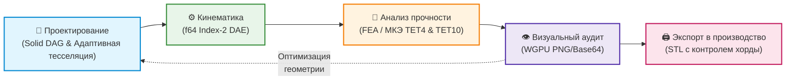
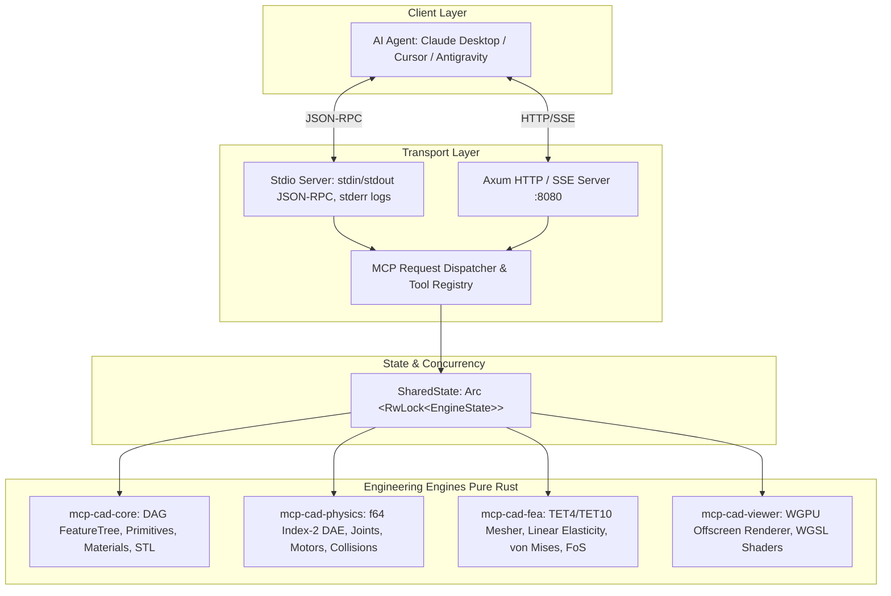

# MCP-CAD Engine: Автономная CAD/CAE система на Rust для ИИ-агентов

<div align="center">

[](https://www.rust-lang.org)
[](https://www.microsoft.com/windows)
[](Cargo.toml)
[](https://modelcontextprotocol.io)
[](TASKS.md)
[](LICENSE)

**Первая в мире автономная инженерная среда 3D CAD/CAE на чистом Rust под Windows, спроектированная под прямое управление ИИ-агентами по протоколу Model Context Protocol (MCP).**

[Быстрый старт](#-быстрый-старт-quick-start) •
[Подключение к ИИ](#-подключение-к-популярным-ии-клиентам) •
[Инструменты MCP](#-сводная-таблица-инструментов-mcp-41-tools) •
[AI-Native Возможности](#-ai-native-cad-experience) •
[Архитектура](#-архитектура-системы) •
[Примеры промптов](#-готовые-промпты-для-ии-агентов)

</div>

---

## 🚀 Что такое MCP-CAD Engine?

Традиционные CAD-пакеты (SolidWorks, ANSYS, FreeCAD) созданы для человека с мышью и графическим интерфейсом. Они сложны для автоматизации, а нейросетевые полигональные генераторы (text-to-3D) создают "визуальные меши", непригодные для точного машиностроения, кинематики и МКЭ.

**MCP-CAD Engine** устраняет этот разрыв: это автономное инженерное ядро на **чистом Rust (Zero C++ dependency)**, предоставляющее мультимодальным моделям (Claude, Antigravity, Cursor, локальным LLM) интерфейс профессионального конструктора и расчетчика:



---

## ✨ Ключевые возможности

1. **Параметрическое Solid DAG-моделирование и адаптивная тесселяция**:
   - Аналитическая геометрия и построение твердых тел на основе направленного графа операций (`FeatureTree`).
   - Примитивы (`Box`, `Cylinder`, `Sphere`, `Cone`, `PolygonPrism` с фасками по DIN 934, параметрический зубчатый венец `SpurGear` с эвольвентным профилем по DIN 867 / ISO 53, ступицей и шпоночным пазом DIN 6885, тела вращения `Revolve` по 2D-профилю `[r, z]`, параметрический легкосплавный колесный диск `WheelRim` со ступенчатым профилем обода, закраинами, монтажным ручьем, ступицей, PCD разболтовкой и спицами с окнами охлаждения тормозов), вырезание отверстий (`cut_hole` с опциональным шпоночным пазом), нарезка винтовых канавок и метрической резьбы 60° по ISO 68-1 (`cut_helical_groove`).
   - **Полная CSG-триада и пространственные трансформации**: вычитание (`boolean_difference`), объединение (`boolean_union`), пересечение произвольных сеток (`boolean_intersection`) и аффинные трансформации (`transform_part`: перемещение, вращение RPY, масштабирование).
   - **Ленивая адаптивная тесселяция (`tessellate_part`)**: автоматическая адаптивная дискретизация криволинейных поверхностей по стреле прогиба (хорде $\delta$) и угловому отклонению $\theta$ с пресетами качества (`Coarse`, `Medium`, `Fine`, `Custom`) и кэшированием меша.
   - Редактирование любого шага истории в реальном времени (`modify_feature`) с автоматической инвалидацией кэша и пересчетом геометрии без потери топологии.

2. **AI-Native интроспекция и пакетная оптимизация**:
   - **Инспекция геометрии (`query_part_geometry`)**: устранение "слепоты координат" у LLM благодаря автодетекции компланарных граней (`detected_planar_faces`), вычислению нормалей, средневзвешенных центров, объема, площади и точного AABB.
   - **Пакетное атомарное выполнение (`batch_cad_operations`)**: выполнение цепочек из десятков CAD-операций за один сетевой запрос с валидацией шагов.

3. **Динамика подвижных механизмов (`f64` Index-2 DAE)**:
   - Полный спектр кинематических сочленений: шарниры (`Revolute`), направляющие ползуны (`Prismatic`), шаровые опоры (`Spherical`), жесткие фиксации (`Fixed`) и связанные зубчатые передачи (`Gear` с прямой передачей крутящего момента).
   - Управляемые сервоприводы с ограничением по пиковому моменту и скорости (`f64`), точный тензор инерции по замкнутой сетке с учётом полостей и собственный конвейер коллизий (`TriMeshBvh`, GJK/EPA, сухое трение Кулона).
   - Симуляция динамики во времени с прямым извлечением реакций Лагранжа $\boldsymbol{\lambda}$ для квазистатического МКЭ (`get_part_load_cases` $\to$ `run_fea_from_simulation`), анализом подвижности (`analyze_mechanism`), проверкой зазоров и замкнутых контуров (`check_interference`, `sweep_joint`).

4. **Линейный МКЭ-анализ прочности (Pure-Rust FEA)**:
   - Автоматическая 3D тетраэдризация геометрии (TET4: 4 узла, 12 DoF) с адаптивной увязкой поверхностного меша и разбиением длинных ребер (`refine_mesh_max_edge_length`).
   - Закон Гука в трехмерном виде через изотропную матрицу упругости $D(E, \nu)$.
   - Разреженный итерационный решатель (Conjugate Gradient) для уравнения равновесия $K \cdot u = F$.
   - Вычисление тензора напряжений Коши, эквивалентных напряжений по Мизесу $\sigma_{vM}$ и коэффициента запаса прочности ($FoS = \sigma_{yield} / \max(\sigma_{vM})$).

5. **WGPU 3D Визуализация и оффскрин-рендеринг**:
   - Нативное 3D-окно Windows (DirectX 12 / Vulkan) с шейдингом Blinn-Phong, контурной обводкой ребер и горячей клавишей `'Q'` для переключения качества тесселяции (Coarse $\to$ Medium $\to$ Fine) на лету.
   - Headless оффскрин-рендеринг в кадровый буфер RGBA8 с кодированием в PNG/Base64 прямо в теле ответа MCP с поддержкой пресетов качества.
   - Процедурные тепловые карты напряжений Мизеса (градиент Синий $\to$ Циан $\to$ Зеленый $\to$ Желтый $\to$ Красный) для мультимодального анализа агентом.

6. **Инженерная библиотека и кастомные материалы**:
   - Стали: `steel_structural_aisi1020`, `steel_high_strength_4140`.
   - Легкие сплавы: авиационный алюминий `aluminum_6061_t6`, титан `titanium_grade5_ti6al4v`, латунь `brass_c360`.
   - Полимеры для 3D-печати: `pla_filament_3dprint`, `petg_filament_3dprint`, инженерный нейлон `nylon_pa12`.
   - **Динамическое создание материалов (`define_material`)**: регистрация пользовательских сплавов, полимеров и композитов с индивидуальными $E$, $\nu$, $\sigma_y$ и $\rho$.

7. **Производственный экспорт и телеметрия**:
   - Экспорт поверхностных сеток в стандартный формат STL (компактный бинарный или текстовый ASCII).
   - Полная телеметрия и структурированные инженерные отчеты в формате JSON.

---

## ⚡ Быстрый старт (Quick Start)

### Системные требования
- **ОС**: Windows 10 или Windows 11 x64, либо Linux (Debian / Ubuntu x86_64).
- **Компилятор**: Rust $\ge 1.91$ (зафиксирован в [`rust-toolchain.toml`](rust-toolchain.toml); зависимости в `Cargo.lock` требуют `rustc >= 1.89`, устанавливается через [rustup.rs](https://rustup.rs)).
- **Видеоподсистема**: Любая видеокарта с поддержкой DirectX 12 или Vulkan (для систем без GPU и контейнеров Linux автоматически подключается программный адаптер Mesa Lavapipe `WGPU_BACKEND=vulkan LIBGL_ALWAYS_SOFTWARE=1`).

### 1. Клонирование и сборка
```powershell
git clone https://github.com/hofabetlife/chordvibe-cad-mcp.git
cd chordvibe-cad-mcp
cargo build --release -p mcp-cad-server
```
*Исполняемый файл будет собран в `./target/release/mcp-cad-server.exe`.*

### 2. Запуск в режиме Stdio (для локальных ИИ-агентов)
```powershell
cargo run --release -p mcp-cad-server -- --mode stdio
```

### 3. Запуск в режиме HTTP / Server-Sent Events (SSE)
```powershell
cargo run --release -p mcp-cad-server -- --mode sse --port 8080
```
*Сервер слушает входящие SSE-соединения на `http://127.0.0.1:8080/sse` и принимает вызовы JSON-RPC через POST на `http://127.0.0.1:8080/message`.*

### 4. Запуск на Linux / macOS и в Docker (Headless GPU / Lavapipe)
Для запуска `mcp-cad-server` в серверных Linux-окружениях и CI/CD без физической видеокарты используется программный драйвер Vulkan (`mesa-vulkan-drivers` / `lavapipe`):
```bash
# Нативный запуск на Linux/macOS:
chmod +x ./run_server.sh
./run_server.sh --mode sse --port 8080

# Сборка и запуск в Docker-контейнере:
docker build -t mcp-cad-server .
docker run --rm -p 8080:8080 mcp-cad-server
```

---

## 🔌 Подключение к популярным ИИ-клиентам

### 1. Claude Desktop (Windows)

Конфигурационный файл Claude Desktop расположен по пути:
```
%APPDATA%\Claude\claude_desktop_config.json
```

Откройте его и добавьте секцию `cad-engine`:

```json
{
  "mcpServers": {
    "cad-engine": {
      "command": "C:\\Users\\<username>\\Documents\\chordvibe-cad-mcp\\target\\release\\mcp-cad-server.exe",
      "args": [
        "--mode",
        "stdio"
      ],
      "env": {
        "RUST_LOG": "info"
      }
    }
  }
}
```

> [!NOTE]
> Подробные инструкции, правила экранирования путей и просмотр логов доступны в [Руководстве по настройке Claude Desktop](docs/CLAUDE_DESKTOP_SETUP.md).

---

### 2. Cursor IDE

1. Откройте **Settings** (`Ctrl+,`) $\to$ вкладка **Features** $\to$ **MCP**.
2. Нажмите **+ Add New MCP Server**.
3. Заполните поля:
   - **Name**: `cad-engine`
   - **Type**: `command`
   - **Command**: `C:\Users\<username>\Documents\chordvibe-cad-mcp\target\release\mcp-cad-server.exe --mode stdio`
4. Нажмите **Save**. Зеленый индикатор подтвердит доступность всех 41 инструментов (полный Rust MCP).

---

### 3. Antigravity и автономные агенты

- **Stdio-подключение**: Укажите бинарник `mcp-cad-server.exe` с аргументом `--mode stdio`. Все логи выводятся строго в `stderr`, сохраняя `stdout` чистым для JSON-RPC.
- **Сетевое подключение (SSE)**: Запустите сервер с ключом `--mode sse --port 8080` и подключите агент по URL `http://127.0.0.1:8080/sse`.

---

## 🧠 AI-Native CAD Experience: Новые горизонты для ИИ-агентов

MCP-CAD Engine спроектирован специально для преодоления фундаментальных проблем LLM в пространственном мышлении и сетевом взаимодействии:

1. **Интроспекция геометрии без «слепоты координат» (`query_part_geometry`)**:
   - Языковые модели не могут визуально «видеть» сетку и часто ошибаются в координатах привязки отверстий, вырезов или сил.
   - Инструмент `query_part_geometry` возвращает точный AABB (min, max, dimensions), абсолютный объем, площадь, центр масс, а главное — массив распознанных компланарных плоскостей (`detected_planar_faces`).
   - Для каждой плоскости автоматически вычисляются точная нормаль $[n_x, n_y, n_z]$ и средневзвешенный центр грани $[x, y, z]$. Агенту достаточно вызвать инспекцию, чтобы безошибочно указать точку и вектор нормали для `cut_hole` или `run_fea_analysis` (`fixed_faces`/`fixed_plane`).

2. **Пакетное атомарное выполнение без задержек (`batch_cad_operations`)**:
   - Сложные детали требуют десятков шагов построения. Выполнение их по одному через отдельные JSON-RPC вызовы создавало десятки лишних roundtrip сетевых задержек.
   - `batch_cad_operations` позволяет агенту скомпоновать полный технологический процесс изготовления детали в один пакетный запрос. Все операции выполняются последовательно и атомарно в одном контексте движка, а в случае ошибки возвращается индекс сбойного шага с точной причиной.

3. **Динамические кастомные материалы (`define_material`)**:
   - Инженерные задачи часто требуют нестандартных материалов: карбон, титановые сплавы, спецстали, композиты или филаменты для 3D-печати.
   - Агент может зарегистрировать любой материал с физическими константами (модуль Юнга $E$, коэффициент Пуассона $\nu$, предел текучести $\sigma_y$, плотность $\rho$) и мгновенно использовать его в расчетах прочности МКЭ и кинематике.

4. **Полный булев базис CSG и пространственные трансформации**:
   - В дополнение к `boolean_difference`, добавлены `boolean_union` (объединение твердых тел) и `boolean_intersection` (пересечение с сохранением общего объема).
   - Инструмент `transform_part` позволяет масштабировать, сдвигать и ориентировать детали по углам Эйлера (Roll-Pitch-Yaw) прямо в истории построения DAG.

5. **Стоимостной оптимизатор дерева операций — Cost-Based CAD Query Optimizer (`optimize_feature_tree` / `EXPLAIN ANALYZE`)**:
   - ИИ-агенты часто строят деталь неоптимальным, но логически верным путем (последовательные поштучные `cut_hole`, цепочки мелких сдвигов `transform_part`, вычитания цилиндров вместо вращения 2D-профиля `revolve`, либо «сверление воздуха» мимо габарита детали).
   - По аналогии с оптимизатором запросов в реляционных СУБД (PostgreSQL `EXPLAIN ANALYZE`), оптимизатор DAG отделяет **Логический план** (что хочет получить ИИ) от **Физического плана** (как дешевле и чище вычислить сетку).
   - Применяет 5 правил алгебраической и геометрической перезаписи (`R1_TRANSFORM_FUSION`, `R2_AABB_DEAD_OP_CULLING`, `R3_DEMORGAN_CSG_BATCH`, `R4_COAXIAL_REVOLVE_REDUCTION`, `R5_ANALYTICAL_PRISM_THREAD_FUSION`), снижая вычислительную стоимость до **60–82%**, устраняя вырожденные треугольники (sliver triangles) перед МКЭ-расчетом TET4 и строго верифицируя сохранение объема ($\Delta V < 0.5\%$), AABB и замкнутости сетки (Watertight).

---

## 🛠️ Сводная таблица инструментов MCP (41 Tools)

| № | Имя инструмента | Входные параметры | Выходные данные | Назначение |
|:---:|---|---|---|---|
| **1** | `create_part` | `name: str`, `material?: str`, `part_id?: str`, `is_fixed?: bool` | `{ part_id: str }` | Создать деталь с заданным материалом и физической фиксацией |
| **2** | `list_parts` | *(нет)* | `{ parts: [...] }` | Получить список всех деталей, габариты и массу |
| **3** | `delete_part` | `part_id: str` | `{ status: "deleted" }` | Удалить деталь из сцены, физики и кэша |
| **4** | `add_feature_primitive` | `part_id: str`, `primitive_type: str`, `params: obj` | `{ feature_id: str }` | Добавить примитив (`box`, `cylinder`, `sphere`, `cone`, `polygon_prism`, `spur_gear`, `revolve`, `wheel_rim`) в DAG |
| **5** | `cut_hole` | `part_id: str`, `position: [3]`, `normal: [3]`, `radius: num`, `depth: num`, `keyway_width?: num`, `keyway_depth?: num` | `{ feature_id: str }` | Вырезать отверстие в твердом теле (опционально со шпоночным пазом DIN 6885) |
| **6** | `modify_feature` | `part_id: str`, `feature_id: str`, `params: obj` | `{ status: "updated", dimensions: [3] }` | Изменить параметры любого шага в истории DAG с транзакционным откатом |
| **7** | `get_feature_tree` | `part_id: str` | `{ dag: [...] }` | Получить полную историю дерева операций детали |
| **8** | `cut_helical_groove` | `part_id: str`, `helix_radius: num`, `groove_radius: num`, `pitch: num`, `height: num`, `start_z: num`, `profile_type?: "circular"\|"metric_60"` | `{ feature_id: str, status: "helical_groove_cut" }` | Нарезать винтовые канавки (канавки сверл или резьбу 60° по ISO 68-1) |
| **9** | `boolean_difference` | `target_part_id?: str` / `part_a_id?: str`, `tool_part_id?: str` / `part_b_id?: str`, `new_part_id?: str` | `{ feature_id: str, status: "boolean_difference_applied" }` | Вычесть форму инструмента из детали (3D CSG Difference) |
| **10** | `boolean_union` | `target_part_id?: str` / `part_a_id?: str`, `tool_part_id?: str` / `part_b_id?: str`, `new_part_id?: str` | `{ target_part_id: str, feature_id: str, status: "union_applied", vertices_count: int, triangles_count: int }` | Булево объединение геометрии инструмента с деталью (3D CSG Union) |
| **11** | `boolean_intersection` | `target_part_id?: str` / `part_a_id?: str`, `tool_part_id?: str` / `part_b_id?: str`, `new_part_id?: str` | `{ target_part_id: str, feature_id: str, status: "intersection_applied", vertices_count: int, triangles_count: int }` | Булево пересечение геометрии инструмента с деталью (3D CSG Intersection) |
| **12** | `transform_part` | `part_id: str`, `translation?: [3]`, `rotation_deg?: [3]`, `scale?: [3]` | `{ part_id: str, feature_id: str, status: "transformed", bounding_box: obj, volume: num }` | Применить смещение, поворот RPY и масштабирование к детали в DAG |
| **13** | `tessellate_part` | `part_id: str`, `quality?: "coarse"\|"medium"\|"fine"`, `chord_tolerance?: num`, `angular_tolerance_deg?: num`, `max_edge_length?: num` | `{ part_id: str, quality: str, vertices_count: int, triangles_count: int }` | Выполнить ленивую адаптивную тесселяцию детали с заданным качеством/допусками хорды |
| **14** | `query_part_geometry` | `part_id: str` | `{ part_id: str, bounding_box: obj, volume: num, surface_area: num, center_of_mass: [3], faces_count: int, vertices_count: int, detected_planar_faces: [...] }` | Детальная топологическая инспекция: AABB, объем, площадь, центр масс и плоские грани |
| **15** | `define_material` | `id: str`, `young_modulus_gpa: num`, `poisson_ratio: num`, `yield_strength_mpa: num`, `density_kg_m3: num`, `name?: str` | `{ status: "material_registered", material_id: str, properties: obj }` | Зарегистрировать кастомный материал для МКЭ прочности и расчета масс |
| **16** | `batch_cad_operations` | `operations: [...]` | `{ success: bool, count: int, results: [...] }` | Пакетное атомарное выполнение цепочки операций без сетевых задержек roundtrip |
| **17** | `create_joint` | `joint_type: str`, `part_a: str`, `part_b: str`, `anchor_a?: [3]`, `anchor_b?: [3]`, `axis?: [3]`, `limits?: [2]`, `ratio?: num` | `{ joint_id: str }` | Создать сочленение (`revolute`, `prismatic`, `spherical`, `fixed`, `gear`) |
| **18** | `set_joint_motor` | `joint_id: str`, `target_velocity: num`, `max_force: num` | `{ status: "motor_active" }` | Включить сервопривод скорости на сочленении |
| **19** | `run_physics_simulation` | `duration_seconds: num`, `step_size_ms?: num` | `{ success: bool, steps_simulated: int, trajectory_summary: obj, peak_joint_forces: obj, collisions: [...] }` | Провести динамическую симуляцию механизма во времени |
| **20** | `run_fea_analysis` | `part_id: str`, `mesh_density?: str`, `element_order?: 1\|2`, `fixed_faces?: [str]`, `fixed_plane?: obj`, `applied_forces?: [...]`, `convergence_study?: bool` | `{ max_von_mises_mpa: num, yield_strength_mpa: num, safety_factor: num, max_displacement_mm: num, status: "PASS"\|"FAIL" }` | Выполнить 3D МКЭ-расчет прочности (`TET4`/`TET10`) |
| **21** | `get_fea_heatmap_image` | `part_id: str`, `camera_preset?: str`, `width?: int`, `height?: int` | `{ colormap_legend: obj }` + `image/png` | Получить 3D-снимок тепловой карты напряжений по Мизесу |
| **22** | `capture_viewport` | `camera_preset?: str`, `part_id?: str`, `width?: int`, `height?: int`, `debug_mode?: bool` | `{ camera_preset: str, format: "image/png" }` + `image/png` | Сделать оффскрин 3D-снимок сцены сборки в высоком разрешении |
| **23** | `export_stl` | `part_id: str`, `filepath: str`, `binary?: bool`, `quality?: "coarse"\|"medium"\|"fine"`, `chord_tolerance?: num` | `{ file_path: str, triangles_count: int }` | Экспортировать деталь в файл STL с адаптивным контролем качества |
| **24** | `get_simulation_metrics_json` | *(нет)* | `{ current_metrics: obj }` | Получить агрегированный отчет по всей сцене и расчетам |
| **25** | `open_preview_window` | `part_id?: str` | `{ status: "opened"\|"preview_window_opened" }` | Открыть или сфокусировать нативное окно 3D-просмотра |
| **26** | `import_stl` | `filepath: str`, `name?: str`, `material?: str` | `{ part_id: str, name: str, vertices_count: int, triangles_count: int, status: "stl_imported" }` | Импортировать готовую 3D-модель STL в сцену и 3D-вьюпорт |
| **27** | `validate_mesh` | `part_id: str`, `expected_genus?: int`, `strict_slivers?: bool` | `{ is_watertight: bool, boundary_edges_count: int, non_manifold_edges_count: int, euler_characteristic: int, genus: int, status: "PASS"\|"WARN"\|"FAIL", topology: obj, geometry: obj, angle_stats: obj }` | Топологическая диагностика замкнутости сетки (Watertight, эйлерова характеристика, род $g$, sliver gate) |
| **28** | `optimize_feature_tree` | `part_id: str`, `apply?: bool` | `{ status: "optimized", applied: bool, logical_nodes_count: int, physical_nodes_count: int, cost_reduction_pct: num, explain_analyze_text: str, ... }` | Стоимостной оптимизатор дерева операций (`EXPLAIN ANALYZE`): перезапись и сжатие DAG с проверкой инвариантов |
| **29** | `set_units` | `length_unit: "mm"\|"m"` | `{ status: "units_updated", length_unit: str }` | Переключить активную единицу длины сессии (`"mm"` по умолчанию или `"m"`) |
| **30** | `save_project` | `path: str`, `project_name?: str` | `{ status: "saved", path: str, schema_version: "1.0.0", file_size_bytes: int, ... }` | Сохранить полное состояние сцены, DAG, шарниры и требования в версионированный JSON |
| **31** | `load_project` | `path: str` | `{ status: "loaded", path: str, parts_count: int, joints_count: int, ... }` | Транзакционно загрузить проект из JSON с пересборкой геометрии и физики |
| **32** | `set_requirements` | `requirements: [...]`, `part_id?: str`, `scope?: "part"\|"scene"`, `auto_check?: bool`, `length_unit?: str` | `{ status: "requirements_set", count: int, auto_check: bool, ... }` | Задать инженерные требования (`bbox_max`, `bbox_min`, `mass_max`, `mesh_valid`, `min_safety_factor`, `no_interference`, `mechanism_dof`) |
| **33** | `check_requirements` | `part_id?: str`, `length_unit?: str` | `{ overall_status: "PASS"\|"FAIL"\|"STALE", passed: int, failed: int, stale: int, results: [...] }` | Проверить зарегистрированные инженерные требования с расчетом запасов и подсказок |
| **34** | `get_scene_summary` | `length_unit?: "mm"\|"m"` | `{ summary_text: str, length_unit: str, parts: [...], joints: [...], requirements: [...] }` | Компактная текстовая и JSON-сводка всей сцены для ИИ-агента |
| **35** | `get_part_load_cases` | `part_id: str`, `select?: "peak_force"\|"peak_torque"\|num`, `length_unit?: str` | `{ part_id: str, time_s: num, joint_reactions: [...], inertial_loads: obj, equilibrium_residual: obj }` | Извлечь динамические реакции в шарнирах и инерционные нагрузки на деталь из симуляции |
| **36** | `run_fea_from_simulation` | `part_id: str`, `select?: str\|num`, `load_radius?: num`, `mesh_density?: str`, `element_order?: 1\|2`, `convergence_study?: bool` | `{ max_von_mises_mpa: num, safety_factor: num, max_displacement_mm: num, source: obj, diagnostics: obj, ... }` | Квазистатический МКЭ-расчет (`TET4`/`TET10`) по нагрузкам симуляции с опорой 3-2-1 |
| **37** | `check_gear_strength` | `part_id?: str`, `module?: num`, `teeth?: int`, `face_width?: num`, `torque?: num`, `power_kw?: num`, `speed_rpm?: num` | `{ bending_stress_mpa: num, bending_safety_factor: num, contact_stress_mpa: num, contact_safety_factor: num, ... }` | Аналитическая проверка прочности зубьев прямозубых шестерён (Льюис / Барт / Герц-AGMA) |
| **38** | `analyze_mechanism` | `part_ids?: [str]`, `rank_tolerance?: num`, `length_unit?: str` | `{ dof_numeric: int, dof_grubler: int, redundant_constraints: int, redundant_joint_ids: [...], joints_at_limits: [...], ... }` | Анализ степеней свободы (Грюблер и SVD Якобиана), упоров `limits` и связности механизма |
| **39** | `check_interference` | `part_ids?: [str]`, `ignore_adjacent?: bool`, `pairs?: [[str, str]]`, `length_unit?: str` | `{ has_interference: bool, interfering_pairs_count: int, min_clearance: num, pairs: [...] }` | Попарная проверка геометрической интерференции и зазоров (`AABB` + `csg_intersection`) |
| **40** | `sweep_joint` | `joint_id: str`, `from: num`, `to: num`, `steps: int`, `ignore_adjacent?: bool`, `angle_unit?: str`, `length_unit?: str` | `{ status: "PASS"\|"FAIL", collision_detected: bool, safe_travel_range: obj, min_clearance: num, lockup_detected: bool, ... }` | Пошаговое сканирование хода шарнира (включая замкнутые контуры) с детекцией коллизий и заклинивания |
| **41** | `apply_recipe` | `recipe: "flanged_bushing"\|"stepped_shaft"\|"gear_transmission"`, `params?: obj`, `length_unit?: "mm"\|"m"` | `{ status: "recipe_applied", recipe: str, created_parts: [str], created_joints: [str], details: obj, ... }` | Атомарно построить типовой узел/сборку из параметрического рецепта с проверкой `validate_mesh` |

> [!TIP]
> Полная документация с примерами JSON-RPC запросов и ответов для всех 41 инструментов представлена в документе [Справочник API инструментов MCP](docs/MCP_API_REFERENCE.md).

---

## 💬 Готовые промпты для ИИ-агентов

Скопируйте любой из этих промптов в диалог с Claude Desktop или Cursor:

### Сценарий 1: Проектирование и оптимизация кронштейна под нагрузку
> *"Спроектируй в MCP-CAD силовой монтажный кронштейн из авиационного алюминия `aluminum_6061_t6`. Базовые размеры основания: 120×15×60 мм. Сделай два крепежных отверстия диаметром 10 мм под болты M8 на координатах x=±30 мм. Закрепи грань min_x и приложи вертикальную силу 800 Н вниз к свободному краю. Запусти МКЭ-расчет прочности (FEA): убедись, что коэффициент запаса прочности (FoS) превышает 2.0. Покажи мне цветовую тепловую карту напряжений и экспортируй готовую деталь в `./output/bracket.stl`."*

### Сценарий 2: Сборка механизма с кинематическим приводом
> *"Создай в MCP-CAD кривошипно-ползунный механизм: неподвижное основание из `steel_structural_aisi1020`, вращающийся кривошип длиной 100 мм из `aluminum_6061_t6` и соединительный шатун. Соедини кривошип с основанием шарниром Revolute по оси Z, подключи мотор с угловой скоростью 6.28 рад/с (1 об/с) и ограничением момента 50 Н·м. Добавь ползун на направляющей (Prismatic). Проведи физическую симуляцию на 2.0 секунды и предоставь мне телеметрию траекторий и пиковых сил в шарнирах."*

---

## 🏛️ Архитектура системы



- Подробный разбор многопоточности, МКЭ-решателя и графического конвейера читайте в [docs/ARCHITECTURE.md](docs/ARCHITECTURE.md).

---

## 🧪 Тестирование и верификация

В репозитории реализован набор юнит-, интеграционных и инвариантных тестов:
- **Инварианты примитивов и CSG (`mcp-cad-core`)**: Проверка водонепроницаемости (`validate_mesh`), внешней ориентации нормалей, характеристики Эйлера ($\chi = 2 - 2g$), отсутствия вырожденных углов (`Sliver Gate`) и аналитических тождеств объёма.
- **Аналитическая верификация МКЭ (`mcp-cad-fea`)**: Проверка решения 3D-задач теории упругости на тетраэдрах `TET4` и квадратичных элементах `TET10` (ошибка прогиба консоли `0.25%`) методом сопряжённых градиентов (PCG).
- **Верификация кинематики и динамики (`mcp-cad-physics`)**: Проверка собственного `f64` DAE/KKT решателя на свободном падении (`< 1e-12`), асимметричном свободном волчке Эйлера (сохранение $T_{\text{rot}}$ и $\|\mathbf{L}\|$ до `< 1e-13`), 10-оборотной зубчатой передаче с передачей момента (`< 1e-7 Н·м`), замкнутых механизмах, коллизиях с трением Кулона (`< 1e-4` на наклоне $30^\circ$) и передаче реакций в МКЭ.
- **Контрактное и сквозное E2E тестирование MCP (`mcp-cad-server`)**: Проверка обработки всех 41 инструментов и соответствия схеме MCP 2024-11-05 (`mcp_contract_tests`, `qa_wide_scan`, `gear_kinematic_test`, `bench_suite`).

> [!IMPORTANT]
> **Требуемая версия Rust и фактическое состояние тестов:**
> - Для сборки и тестирования используется **Rust `1.91`** (зафиксирован в [`rust-toolchain.toml`](rust-toolchain.toml) с компонентами `rustfmt`, `clippy`; зависимости в `Cargo.lock` требуют `rustc >= 1.89`, проверено на `rustc 1.91.1` и `rustc 1.97.1`).
> - **Rust Workspace (`348/348 PASS`, `0 failed`)**: тесты всех 5 крейтов (`mcp-cad-core` `133/133`, `mcp-cad-fea` `21/21`, `mcp-cad-physics` `42/42`, `mcp-cad-viewer` `10/10`, `mcp-cad-server` `142/142`) проходят без ошибок в стандартном многопоточном режиме `cargo test --workspace --no-fail-fast` (`qa_wide_scan` изолирован во временный каталог).
> - **TypeScript / Web Studio (`npm test`)**: **53/53 PASS** (`38` тестов в [`src/cad/cad_engine.test.ts`](src/cad/cad_engine.test.ts) + `15` тестов в [`src/cad/__tests__/analyze_mechanism.test.ts`](src/cad/__tests__/analyze_mechanism.test.ts)), `npm run lint` (`tsc --noEmit`) — **0 ошибок**, `npm run build` — **PASS**.
> - **Clippy (`cargo clippy --workspace --all-targets -- -D warnings`)**: **0 ошибок, 0 предупреждений** во всех 5 крейтах workspace (строгий гейт в CI).
> - Актуальный источник истины по статусу тестов, точным счётчикам и открытым задачам — [`TASKS.md`](TASKS.md) и [`PROJECT_CONTEXT.md`](PROJECT_CONTEXT.md) (раздел 7; исторические отчёты в каталоге `qa/` устарели).

Запуск всего набора тестов (требуется **Rust $\ge 1.91$**):
```bash
# Windows (PowerShell):
cargo test --workspace --no-fail-fast

# Linux / Headless CI (с программным драйвером Vulkan Lavapipe):
WGPU_BACKEND=vulkan LIBGL_ALWAYS_SOFTWARE=1 cargo test --workspace --no-fail-fast
```
Проверка линтером Clippy и тесты веб-клиента:
```bash
cargo clippy --workspace --all-targets -- -D warnings
npm run lint
npm run build
npm test
# или напрямую через tsx:
npx tsx --test src/cad/cad_engine.test.ts src/cad/__tests__/analyze_mechanism.test.ts
```

---

## 📂 Структура репозитория

```
chordvibe-cad-mcp/
├── Cargo.toml                    # Корневой workspace-манифест
├── rust-toolchain.toml           # Фиксация тулчейна Rust 1.91 (rustfmt, clippy)
├── .github/workflows/ci.yml      # GitHub Actions CI (rust, clippy, web)
├── PRD.md                        # Документ требований к продукту
├── PROJECT_CONTEXT.md            # Единый источник правды по архитектуре и контрактам
├── TASKS.md                      # Актуальный бэклог и реестр задач
├── README.md                     # Главная страница (данный файл)
├── docs/
│   ├── ARCHITECTURE.md           # Глубокий архитектурный обзор
│   ├── MCP_API_REFERENCE.md      # Исчерпывающий справочник инструментов MCP
│   └── CLAUDE_DESKTOP_SETUP.md   # Руководство по подключению к Claude Desktop
├── examples/
│   ├── bracket_design.json       # Пример проекта силового L-кронштейна
│   └── crank_mechanism.json      # Пример проекта кривошипно-шатунного механизма
├── src/cad/                      # TypeScript CAD/kinematics/FEA слой и тесты (cad_engine.test.ts, __tests__/)
└── crates/
    ├── mcp-cad-core/             # Геометрическое ядро, Solid DAG, материалы, STL
    ├── mcp-cad-physics/          # Собственный f64 Index-2 DAE/KKT-решатель динамики, коллизий и шарниров
    ├── mcp-cad-fea/              # 3D тетраэдризация и линейный МКЭ-солвер
    ├── mcp-cad-viewer/           # Графический WGPU/WGSL рендерер и снимки
    └── mcp-cad-server/           # MCP JSON-RPC сервер (stdio и HTTP/SSE)
```

---

## 📄 Лицензия

Проект распространяется под двойной лицензией **MIT** или **Apache-2.0** по вашему выбору.
