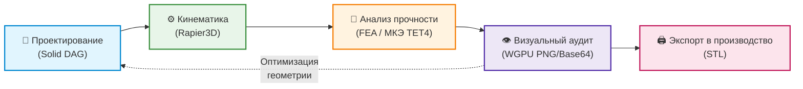
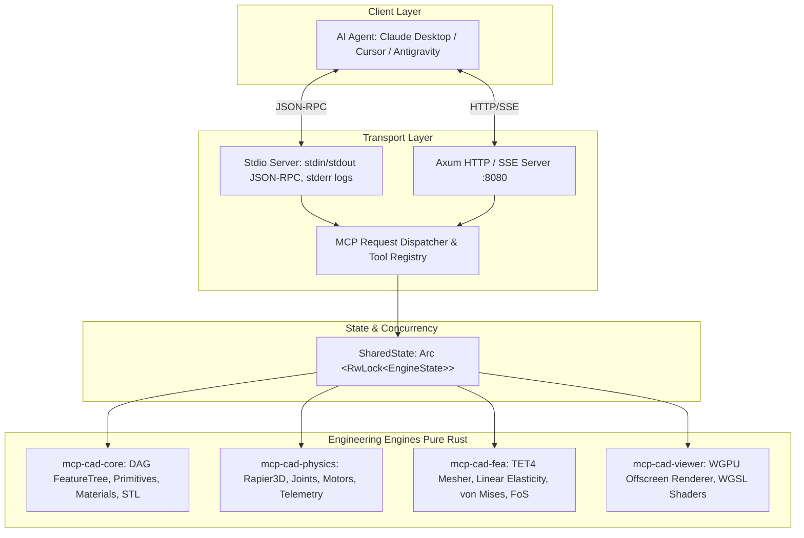

# MCP-CAD Engine: Автономная CAD/CAE система на Rust для ИИ-агентов

<div align="center">

[](https://www.rust-lang.org)
[](https://www.microsoft.com/windows)
[](Cargo.toml)
[](https://modelcontextprotocol.io)
[-success.svg)](crates/)
[](LICENSE)

**Первая в мире автономная инженерная среда 3D CAD/CAE на чистом Rust под Windows, спроектированная под прямое управление ИИ-агентами по протоколу Model Context Protocol (MCP).**

[Быстрый старт](#-быстрый-старт-quick-start) •
[Подключение к ИИ](#-подключение-к-популярным-ии-клиентам) •
[Инструменты MCP](#-сводная-таблица-инструментов-mcp-15-tools) •
[Архитектура](#-архитектура-системы) •
[Примеры промптов](#-готовые-промпты-для-ии-агентов)

</div>

---

## 🚀 Что такое MCP-CAD Engine?

Традиционные CAD-пакеты (SolidWorks, ANSYS, FreeCAD) созданы для человека с мышью и графическим интерфейсом. Они сложны для автоматизации, а нейросетевые полигональные генераторы (text-to-3D) создают "визуальные меши", непригодные для точного машиностроения, кинематики и МКЭ.

**MCP-CAD Engine** устраняет этот разрыв: это автономное инженерное ядро на **чистом Rust (Zero C++ dependency)**, предоставляющее мультимодальным моделям (Claude, Antigravity, Cursor, локальным LLM) интерфейс профессионального конструктора и расчетчика:



---

## ✨ Ключевые возможности

1. **Параметрическое Solid DAG-моделирование**:
   - Построение твердых тел на основе направленного графа операций (`FeatureTree`).
   - Примитивы (`Box`, `Cylinder`, `Sphere`, `Cone`, `PolygonPrism` с фасками по DIN 934, параметрический зубчатый венец `SpurGear` с эвольвентным профилем по DIN 867 / ISO 53, ступицей и шпоночным пазом DIN 6885, тела вращения `Revolve` по 2D-профилю `[r, z]`, параметрический легкосплавный колесный диск `WheelRim` со ступенчатым профилем обода, закраинами, монтажным ручьем, ступицей, PCD разболтовкой и спицами с окнами охлаждения тормозов), вырезание отверстий (`cut_hole` с опциональным шпоночным пазом), нарезка винтовых канавок и метрической резьбы 60° по ISO 68-1 (`cut_helical_groove`), булево вычитание произвольных сеток (`boolean_difference`) и трансформации.
   - Редактирование любого шага истории в реальном времени (`modify_feature`) с автоматическим пересчетом геометрии без потери топологии.

2. **Динамика подвижных механизмов (Rapier3D)**:
   - Полный спектр кинематических сочленений: шарниры (`Revolute`), направляющие ползуны (`Prismatic`), шаровые опоры (`Spherical`) и жесткие фиксации (`Fixed`).
   - Управляемые сервомоторы с ограничением по пиковому моменту и скорости.
   - Симуляция динамики во времени с фиксацией траекторий, реакций в сочленениях и соударений.

3. **Линейный МКЭ-анализ прочности (Pure-Rust FEA)**:
   - Автоматическая 3D тетраэдризация геометрии (TET4: 4 узла, 12 DoF).
   - Закон Гука в трехмерном виде через изотропную матрицу упругости $D(E, \nu)$.
   - Разреженный итерационный решатель (Conjugate Gradient) для уравнения равновесия $K \cdot u = F$.
   - Вычисление тензора напряжений Коши, эквивалентных напряжений по Мизесу $\sigma_{vM}$ и коэффициента запаса прочности ($FoS = \sigma_{yield} / \max(\sigma_{vM})$).

4. **WGPU 3D Визуализация и оффскрин-рендеринг**:
   - Нативное 3D-окно Windows (DirectX 12 / Vulkan) с шейдингом Blinn-Phong и контурной обводкой ребер.
   - Headless оффскрин-рендеринг в кадровый буфер RGBA8 с кодированием в PNG/Base64 прямо в теле ответа MCP.
   - Процедурные тепловые карты напряжений Мизеса (градиент Синий $\to$ Циан $\to$ Зеленый $\to$ Желтый $\to$ Красный) для мультимодального анализа агентом.

5. **Встроенная инженерная библиотека материалов**:
   - Стали: `steel_structural_aisi1020`, `steel_high_strength_4140`.
   - Легкие сплавы: авиационный алюминий `aluminum_6061_t6`, титан `titanium_grade5_ti6al4v`, латунь `brass_c360`.
   - Полимеры для 3D-печати: `pla_filament_3dprint`, `petg_filament_3dprint`, инженерный нейлон `nylon_pa12`.

6. **Производственный экспорт и телеметрия**:
   - Экспорт поверхностных сеток в стандартный формат STL (компактный бинарный или текстовый ASCII).
   - Полная телеметрия и структурированные инженерные отчеты в формате JSON.

---

## ⚡ Быстрый старт (Quick Start)

### Системные требования
- **ОС**: Windows 10 или Windows 11 x64.
- **Компилятор**: Rust $\ge 1.80$ (устанавливается через [rustup.rs](https://rustup.rs)).
- **Видеоподсистема**: Любая видеокарта с поддержкой DirectX 12 или Vulkan (для систем без GPU автоматически подключается программный адаптер).

### 1. Клонирование и сборка
```powershell
git clone https://github.com/your-username/3D_MCP.git
cd 3D_MCP
cargo build --release -p mcp-cad-server
```
*Исполняемый файл будет собран в `./target/release/mcp-cad-server.exe`.*

### 2. Запуск в режиме Stdio (для локальных ИИ-агентов)
```powershell
cargo run --release -p mcp-cad-server -- --mode stdio
```

### 3. Запуск в режиме HTTP / Server-Sent Events (SSE)
```powershell
cargo run --release -p mcp-cad-server -- --mode sse --port 8080
```
*Сервер слушает входящие SSE-соединения на `http://127.0.0.1:8080/sse` и принимает вызовы JSON-RPC через POST на `http://127.0.0.1:8080/message`.*

---

## 🔌 Подключение к популярным ИИ-клиентам

### 1. Claude Desktop (Windows)

Конфигурационный файл Claude Desktop расположен по пути:
```
%APPDATA%\Claude\claude_desktop_config.json
```

Откройте его и добавьте секцию `cad-engine`:

```json
{
  "mcpServers": {
    "cad-engine": {
      "command": "c:\\Users\\voley\\Documents\\3D_MCP\\target\\release\\mcp-cad-server.exe",
      "args": [
        "--mode",
        "stdio"
      ],
      "env": {
        "RUST_LOG": "info"
      }
    }
  }
}
```

> [!NOTE]
> Подробные инструкции, правила экранирования путей и просмотр логов доступны в [Руководстве по настройке Claude Desktop](docs/CLAUDE_DESKTOP_SETUP.md).

---

### 2. Cursor IDE

1. Откройте **Settings** (`Ctrl+,`) $\to$ вкладка **Features** $\to$ **MCP**.
2. Нажмите **+ Add New MCP Server**.
3. Заполните поля:
   - **Name**: `cad-engine`
   - **Type**: `command`
   - **Command**: `c:\Users\voley\Documents\3D_MCP\target\release\mcp-cad-server.exe --mode stdio`
4. Нажмите **Save**. Зеленый индикатор подтвердит доступность всех 15 инструментов.

---

### 3. Antigravity и автономные агенты

- **Stdio-подключение**: Укажите бинарник `mcp-cad-server.exe` с аргументом `--mode stdio`. Все логи выводятся строго в `stderr`, сохраняя `stdout` чистым для JSON-RPC.
- **Сетевое подключение (SSE)**: Запустите сервер с ключом `--mode sse --port 8080` и подключите агент по URL `http://127.0.0.1:8080/sse`.

---

## 🛠️ Сводная таблица инструментов MCP (18 Tools)

| № | Имя инструмента | Входные параметры | Выходные данные | Назначение |
|:---:|---|---|---|---|
| **1** | `create_part` | `name: str`, `material: str` | `{ part_id: str }` | Создать деталь с заданным материалом |
| **2** | `list_parts` | *(нет)* | `{ parts: [...] }` | Получить список всех деталей, габариты и массу |
| **3** | `delete_part` | `part_id: str` | `{ status: "deleted" }` | Удалить деталь из сцены, физики и кэша |
| **4** | `add_feature_primitive` | `part_id: str`, `primitive_type: str`, `params: obj` | `{ feature_id: str }` | Добавить примитив (`box`, `cylinder`, `sphere`, `cone`, `polygon_prism`, `spur_gear`, `revolve`, `wheel_rim`) в DAG |
| **5** | `cut_hole` | `part_id: str`, `position: [3]`, `normal: [3]`, `radius: num`, `depth: num`, `keyway_width?: num`, `keyway_depth?: num` | `{ feature_id: str }` | Вырезать отверстие в твердом теле (опционально со шпоночным пазом DIN 6885) |
| **6** | `modify_feature` | `part_id: str`, `feature_id: str`, `params: obj` | `{ status: "updated", dimensions: [3] }` | Изменить параметры любого шага в истории DAG |
| **7** | `get_feature_tree` | `part_id: str` | `{ dag: [...] }` | Получить полную историю дерева операций детали |
| **8** | `cut_helical_groove` | `part_id: str`, `helix_radius: num`, `groove_radius: num`, `pitch: num`, `height: num`, `start_z: num`, `profile_type?: "circular"\|"metric_60"` | `{ feature_id: str, status: "helical_groove_cut" }` | Нарезать винтовые канавки (канавки сверл или резьбу 60° по ISO 68-1) |
| **9** | `boolean_difference` | `target_part_id: str`, `tool_part_id: str` | `{ feature_id: str, status: "boolean_difference_applied" }` | Вычесть форму инструмента из детали (CSG Difference) |
| **10** | `create_joint` | `joint_type: str`, `part_a: str`, `part_b: str`, `anchor_a: [3]`, `anchor_b: [3]`, `axis?: [3]`, `limits?: [2]` | `{ joint_id: str }` | Создать сочленение (`revolute`, `prismatic`, `spherical`, `fixed`) |
| **11** | `set_joint_motor` | `joint_id: str`, `target_velocity: num`, `max_force: num` | `{ status: "motor_active" }` | Включить сервопривод скорости на сочленении |
| **12** | `run_physics_simulation` | `duration_seconds: num`, `step_size_ms?: num` | `{ success: bool, steps_simulated: int, trajectory_summary: obj, peak_joint_forces: obj, collisions: [...] }` | Провести динамическую симуляцию механизма во времени |
| **13** | `run_fea_analysis` | `part_id: str`, `mesh_density?: str`, `fixed_faces?: [str]`, `fixed_plane?: obj`, `applied_forces?: [...]` | `{ max_von_mises_mpa: num, yield_strength_mpa: num, safety_factor: num, max_displacement_mm: num, status: "PASS"\|"FAIL" }` | Выполнить 3D МКЭ-расчет прочности (TET4) |
| **14** | `get_fea_heatmap_image` | `part_id: str`, `camera_preset?: str`, `width?: int`, `height?: int` | `{ colormap_legend: obj }` + `image/png` | Получить 3D-снимок тепловой карты напряжений по Мизесу |
| **15** | `capture_viewport` | `camera_preset?: str`, `part_id?: str`, `width?: int`, `height?: int` | `{ camera_preset: str, format: "image/png" }` + `image/png` | Сделать оффскрин 3D-снимок сцены сборки в высоком разрешении |
| **16** | `export_stl` | `part_id: str`, `filepath: str`, `binary?: bool` | `{ file_path: str, triangles_count: int }` | Экспортировать деталь в файл STL для 3D-печати |
| **17** | `get_simulation_metrics_json` | *(нет)* | `{ current_metrics: obj }` | Получить агрегированный отчет по всей сцене и расчетам |
| **18** | `open_preview_window` | `part_id?: str` | `{ status: "preview_window_opened" }` | Открыть или сфокусировать нативное окно 3D-просмотра |
| **19** | `import_stl` | `filepath: str`, `name?: str`, `material?: str` | `{ part_id: str, name: str, vertices_count: int, triangles_count: int, status: "stl_imported" }` | Импортировать готовую 3D-модель STL в сцену и 3D-вьюпорт |

> [!TIP]
> Полная документация с примерами JSON-RPC запросов и ответов для всех 15 инструментов представлена в документе [Справочник API инструментов MCP](docs/MCP_API_REFERENCE.md).

---

## 💬 Готовые промпты для ИИ-агентов

Скопируйте любой из этих промптов в диалог с Claude Desktop или Cursor:

### Сценарий 1: Проектирование и оптимизация кронштейна под нагрузку
> *"Спроектируй в MCP-CAD силовой монтажный кронштейн из авиационного алюминия `aluminum_6061_t6`. Базовые размеры основания: 120×15×60 мм. Сделай два крепежных отверстия диаметром 10 мм под болты M8 на координатах x=±30 мм. Закрепи грань min_x и приложи вертикальную силу 800 Н вниз к свободному краю. Запусти МКЭ-расчет прочности (FEA): убедись, что коэффициент запаса прочности (FoS) превышает 2.0. Покажи мне цветовую тепловую карту напряжений и экспортируй готовую деталь в `./output/bracket.stl`."*

### Сценарий 2: Сборка механизма с кинематическим приводом
> *"Создай в MCP-CAD кривошипно-ползунный механизм: неподвижное основание из `steel_structural_aisi1020`, вращающийся кривошип длиной 100 мм из `aluminum_6061_t6` и соединительный шатун. Соедини кривошип с основанием шарниром Revolute по оси Z, подключи мотор с угловой скоростью 6.28 рад/с (1 об/с) и ограничением момента 50 Н·м. Добавь ползун на направляющей (Prismatic). Проведи физическую симуляцию на 2.0 секунды и предоставь мне телеметрию траекторий и пиковых сил в шарнирах."*

---

## 🏛️ Архитектура системы



- Подробный разбор многопоточности, МКЭ-решателя и графического конвейера читайте в [docs/ARCHITECTURE.md](docs/ARCHITECTURE.md).

---

## 🧪 Тестирование и верификация

В репозитории реализован полный набор юнит-, интеграционных и верификационных тестов:
- **Аналитическая верификация МКЭ**: Сравнение численного прогиба консольной балки под изгибом с теоретической формулой сопротивления материалов ($\delta = \frac{F L^3}{3 E I}$, совпадение с точностью до 5%).
- **Верификация кинематики**: Тестирование степеней свободы сочленений Rapier3D, работы моторов и детекции коллизий.
- **Сквозное E2E тестирование MCP**: Проверка обработки всех 15 инструментов и соответствия схеме MCP 2024-11-05.

Запуск всего набора тестов:
```powershell
cargo test --workspace
```
Проверка линтером без предупреждений:
```powershell
cargo clippy --workspace -- -D warnings
```

---

## 📂 Структура репозитория

```
3D_MCP/
├── Cargo.toml                    # Корневой workspace-манифест
├── PRD.md                        # Документ требований к продукту
├── PROJECT_CONTEXT.md            # Контекст и соглашения разработки
├── README.md                     # Главная страница (данный файл)
├── docs/
│   ├── ARCHITECTURE.md           # Глубокий архитектурный обзор
│   ├── MCP_API_REFERENCE.md      # Исчерпывающий справочник всех 15 инструментов
│   └── CLAUDE_DESKTOP_SETUP.md   # Руководство по подключению к Claude Desktop
├── examples/
│   ├── bracket_design.json       # Пример проекта силового L-кронштейна
│   └── crank_mechanism.json      # Пример проекта кривошипно-шатунного механизма
└── crates/
    ├── mcp-cad-core/             # Геометрическое ядро, Solid DAG, материалы, STL
    ├── mcp-cad-physics/          # Физика кинематики и сочленений Rapier3D
    ├── mcp-cad-fea/              # 3D тетраэдризация и линейный МКЭ-солвер
    ├── mcp-cad-viewer/           # Графический WGPU/WGSL рендерер и снимки
    └── mcp-cad-server/           # MCP JSON-RPC сервер (stdio и HTTP/SSE)
```

---

## 📄 Лицензия

Проект распространяется под двойной лицензией **MIT** или **Apache-2.0** по вашему выбору.
