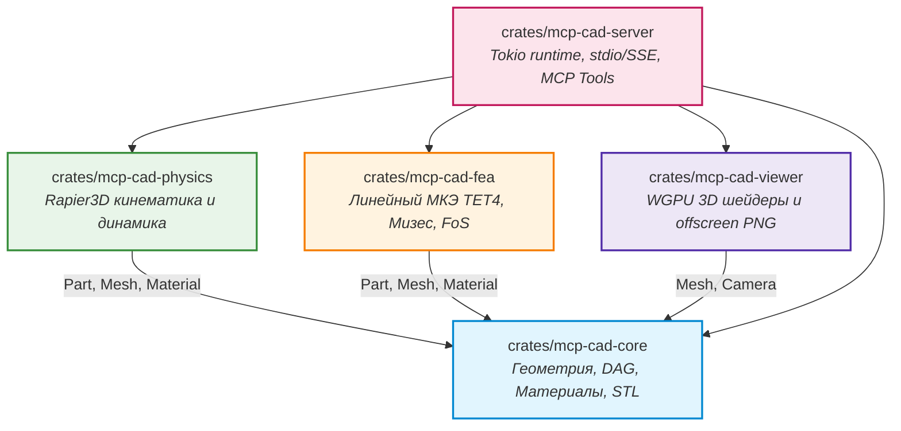
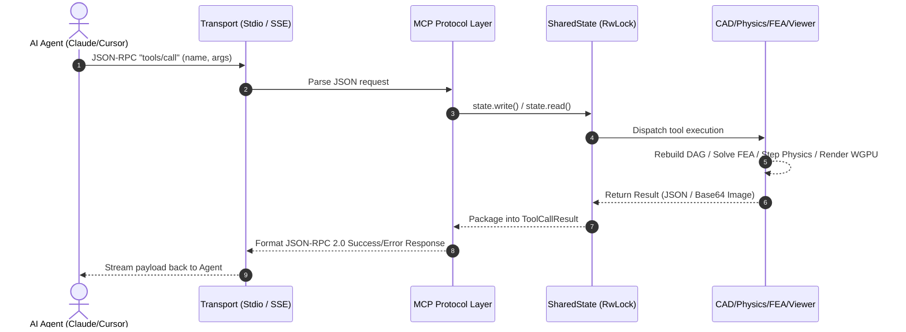

# Архитектура MCP-CAD Engine

> **Автономная инженерная 3D CAD/CAE система на чистом Rust под Windows для ИИ-агентов.**

---

## 1. Введение и Архитектурные Принципы

MCP-CAD Engine спроектирован для того, чтобы дать современным мультимодальным LLM и автономным ИИ-агентам (Claude, Antigravity, Cursor) полноценный инструментарий инженера-конструктора и расчетчика. В отличие от традиционных пакетов (SolidWorks, ANSYS, FreeCAD), где управление завязано на сотни кнопок и контекстных меню, MCP-CAD предоставляет детерминированный, строго типизированный протокольный интерфейс по стандарту **Model Context Protocol (MCP)**.

### Фундаментальные принципы проектирования:
1. **Pure Rust (Zero C++ Dependencies)**: Полный отказ от внешних компилируемых C/C++ библиотек (OpenCASCADE, MSVC C++ SDK, CMake, Clang). Все модули — от геометрических вычислений до МКЭ и физики — реализованы на 100% безопасном коде Rust (`#![deny(unsafe_code)]` в расчетных крейтах).
2. **Параметрическая история без потерь (Solid DAG)**: Моделирование строится в виде направленного ациклического графа операций. Любой шаг в истории может быть отредактирован без необходимости пересоздавать деталь.
3. **Замкнутый автономный цикл (Closed-Loop Autonomous Engineering)**:
   $$\text{Геометрия (DAG)} \longrightarrow \text{Кинематика (Rapier3D)} \longrightarrow \text{Прочность (FEA)} \longrightarrow \text{Визуальный аудит (WGPU)} \longrightarrow \text{STL Экспорт}$$
4. **Строгая изоляция потоков ввода-вывода (Stdio Hygiene)**: В режиме `stdio` дескриптор `stdout` зарезервирован исключительно под JSON-RPC сообщения MCP. Любые диагностические логи (`tracing`, `eprintln!`) маршрутизируются строго в `stderr`.
5. **Мультимодальное зрение для ИИ**: Встроенный WGPU рендерер генерирует кадры высокого разрешения и тепловые карты напряжений в Base64/PNG, позволяя LLM визуально верифицировать результат.

---

## 2. Структура Cargo Workspace

Проект разделен на 5 независимых крейтов с четко разграниченными зонами ответственности:

```
c:\Users\voley\Documents\3D_MCP\
├── Cargo.toml                    # Корневой Workspace манифест (resolver = "2")
├── PRD.md                        # Спецификация требований к продукту
├── PROJECT_CONTEXT.md            # Контекст и соглашения разработки
├── README.md                     # Главная страница документации
├── docs/                         # Техническая документация
│   ├── ARCHITECTURE.md           # Архитектурный обзор (данный документ)
│   ├── MCP_API_REFERENCE.md      # Полный справочник 15 инструментов MCP
│   └── CLAUDE_DESKTOP_SETUP.md   # Руководство по интеграции с Claude Desktop
├── examples/                     # Готовые инженерные сценарии
│   ├── bracket_design.json       # Проект кронштейна с расчетом прочности
│   └── crank_mechanism.json      # Проект механизма с динамикой привода
└── crates/
    ├── mcp-cad-core/             # Геометрическое ядро, B-Rep/CSG, DAG, материалы, STL
    ├── mcp-cad-physics/          # Интеграция Rapier3D, сочленения, моторы, симуляция
    ├── mcp-cad-fea/              # 3D тетраэдризация TET4, линейный МКЭ, Мизес, FoS
    ├── mcp-cad-viewer/           # Графический конвейер WGPU, WGSL шейдеры, оффскрин-рендеринг
    └── mcp-cad-server/           # Точка входа, транспорты stdio / SSE, диспетчер инструментов
```

### Диаграмма зависимостей компонентов



---

## 3. Модель состояния и многопоточность (`SharedState`)

Серверная часть спроектирована на асинхронном рантайме **Tokio**. Централизованное состояние инженерного мира инкапсулировано в структуре `EngineState` и разделяется между запросами через потокобезопасную обертку:

```rust
pub type SharedState = Arc<parking_lot::RwLock<EngineState>>;
```

### Структура `EngineState`

```rust
pub struct EngineState {
    pub materials: MaterialRegistry,
    pub parts: HashMap<String, Part>,
    pub physics_world: PhysicsWorld,
    pub last_fea_reports: HashMap<String, FeaReport>,
    pub last_fea_meshes: HashMap<String, TetrahedralMesh>,
    pub last_simulation: Option<SimulationSummary>,
    pub offscreen_renderer: Arc<OffscreenRenderer>,
}
```

### Механика синхронизации и предотвращение взаимных блокировок (Deadlock-Free):
- **Тонкая гранулярность блокировок**: Чтение состояния (`state.read()`) используется для запросов, не мутирующих сцену (`list_parts`, `get_feature_tree`, `get_simulation_metrics_json`).
- **Изолированные транзакции записи**: Блокировка на запись (`state.write()`) захватывается исключительно на время исполнения конкретного инструмента в `dispatch_tool` и немедленно освобождается перед отправкой ответа.
- **WGPU рендерер**: `OffscreenRenderer` обернут в `Arc` и не блокирует глобальное состояние детали во время отрисовки кадров.

---

## 4. Подсистемы движка

### 4.1. Геометрическое ядро (`mcp-cad-core`)
- **Параметрический DAG (`FeatureTree`)**: Каждый шаг моделирования регистрируется в виде узла `FeatureNode` с уникальным `Uuid`. Поддерживаемые операции:
  - `AddBox { width, height, depth }`
  - `AddCylinder { radius, height, segments }`
  - `AddSphere { radius, sectors, stacks }`
  - `CutHole { center, normal, radius, depth }`
  - `Transform { translation, rotation_deg, scale }`
- **Пересчет геометрии (`rebuild`)**: При вызове `modify_feature` ядро заново выполняет последовательность операций DAG, гарантируя консистентность геометрии без потери топологической информации.
- **Расчет масс-инерционных характеристик**: Автоматическое интегрирование объема по замкнутой полигональной сетке `TriangleMesh` с вычислением центра масс, массы $m = \rho \cdot V$ и тензора инерции $I_{xx}, I_{yy}, I_{zz}$.
- **Инженерная база материалов (`MaterialRegistry`)**: Предустановленные константы для сплавов и полимеров:
  - `aluminum_6061_t6` ($E=68.9$ GPa, $\nu=0.33$, $\sigma_y=276$ MPa, $\rho=2700$ kg/m³)
  - `steel_structural_aisi1020` ($E=205.0$ GPa, $\nu=0.29$, $\sigma_y=250$ MPa, $\rho=7850$ kg/m³)
  - `steel_high_strength_4140` ($E=210.0$ GPa, $\nu=0.30$, $\sigma_y=655$ MPa, $\rho=7850$ kg/m³)
  - `titanium_grade5_ti6al4v` ($E=114.0$ GPa, $\nu=0.34$, $\sigma_y=880$ MPa, $\rho=4430$ kg/m³)
  - `brass_c360` ($E=100.0$ GPa, $\nu=0.34$, $\sigma_y=310$ MPa, $\rho=8500$ kg/m³)
  - `pla_filament_3dprint` ($E=3.5$ GPa, $\nu=0.36$, $\sigma_y=60$ MPa, $\rho=1240$ kg/m³)
  - `petg_filament_3dprint` ($E=2.1$ GPa, $\nu=0.38$, $\sigma_y=50$ MPa, $\rho=1270$ kg/m³)
  - `nylon_pa12` ($E=1.8$ GPa, $\nu=0.40$, $\sigma_y=45$ MPa, $\rho=1010$ kg/m³)

---

### 4.2. Кинематика и физика механизмов (`mcp-cad-physics`)
- Базируется на физическом движке **Rapier3D** (Pure Rust, SIMD-оптимизированный).
- Автоматически создает `RigidBody` и `Collider` (TriMesh / Convex Hull) на основе триангулированной сетки `Part`.
- **Менеджер кинематических пар (`JointManager`)**:
  - `Revolute`: вращательный шарнир с фиксацией оси вращения, пределами углов и возможностью подключения мотора скорости.
  - `Prismatic`: поступательный ползун/слайдер с направляющей осью и лимитами перемещения.
  - `Spherical`: шаровой сферический шарнир (3 степени свободы вращения).
  - `Fixed`: жесткая связка деталей.
- **Приводы (Motors)**: Плавное поддержание целевой скорости (`target_velocity`) с ограничением по пиковому моменту/силе (`max_force`).
- **Сбор телеметрии (`SimulationSummary`)**: Дискретное интегрирование с шагом $\Delta t$, фиксация пространственных траекторий $P(t)$, ориентаций $Q(t)$, реакций в шарнирах и коллизий.

---

### 4.3. Конечно-элементный анализ прочности (`mcp-cad-fea`)
- **Объемная сетка (TET4)**: Автоматическая тетраэдризация триангулированной геометрии детали (4 узла на элемент, 3 степени свободы $u_x, u_y, u_z$ на узел, всего 12 DoF на элемент).
- **Матрица упругости изотропного тела $D$ (Закон Гука в 3D)**:
  $$D = \frac{E}{(1+\nu)(1-2\nu)} \begin{bmatrix} 1-\nu & \nu & \nu & 0 & 0 & 0 \\ \nu & 1-\nu & \nu & 0 & 0 & 0 \\ \nu & \nu & 1-\nu & 0 & 0 & 0 \\ 0 & 0 & 0 & \frac{1-2\nu}{2} & 0 & 0 \\ 0 & 0 & 0 & 0 & \frac{1-2\nu}{2} & 0 \\ 0 & 0 & 0 & 0 & 0 & \frac{1-2\nu}{2} \end{bmatrix}$$
- **Элементная матрица жесткости**:
  $$K_e = V_e B^T D B \quad (12 \times 12)$$
  где $V_e$ — объем тетраэдра, $B$ ($6 \times 12$) — матрица градиентов формы.
- **Глобальная сборка и решатель**:
  Глобальная матрица жесткости $K$ собирается в разреженном формате CSR (Compressed Sparse Row). Граничные условия Дирихле (закрепление граней `fixed_faces` или плоскостей `fixed_plane`) и нагрузки Неймана (сосредоточенные и распределенные силы) применяются к системе $K u = F$. Решение вычисляется методом сопряженных градиентов (Conjugate Gradient) с контролем невязки и защитным таймаутом (10 с).
- **Тензор напряжений Коши и эквивалентные напряжения по Мизесу**:
  $$\sigma = D B u_e = [\sigma_x, \sigma_y, \sigma_z, \tau_{xy}, \tau_{yz}, \tau_{zx}]^T$$
  $$\sigma_{vM} = \sqrt{\frac{1}{2} \left[ (\sigma_x - \sigma_y)^2 + (\sigma_y - \sigma_z)^2 + (\sigma_z - \sigma_x)^2 + 6(\tau_{xy}^2 + \tau_{yz}^2 + \tau_{zx}^2) \right]}$$
- **Коэффициент запаса прочности (Factor of Safety)**:
  $$FoS = \frac{\sigma_{\text{yield}}}{\max(\sigma_{vM})}, \quad \text{Verdict} = \begin{cases} \text{"PASS"}, & FoS \ge 1.0 \\ \text{"FAIL"}, & FoS < 1.0 \end{cases}$$

---

### 4.4. Визуализация и рендеринг (`mcp-cad-viewer`)
- **Графический стек**: Построен на **WGPU 22** поверх нативных графических бэкендов Windows (DirectX 12 / Vulkan).
- **Headless Offscreen Buffer**: Рендеринг кадра в текстуру `wgpu::TextureFormat::Rgba8Unorm` с соблюдением выравнивания строк видеопамяти по 256 байт (`COPY_BYTES_PER_ROW_ALIGNMENT`).
- **Шейдеры WGSL**:
  - `cad_mesh.wgsl`: Blinn-Phong затенение твердых тел с направленным светом и контурным каркасом ребер.
  - `fea_heatmap.wgsl`: Процедурная интерполяция напряжений по цветовой градиентной шкале:
    $$\text{Синий } (0.0) \longrightarrow \text{Циан } (0.25) \longrightarrow \text{Зеленый } (0.5) \longrightarrow \text{Желтый } (0.75) \longrightarrow \text{Красный } (1.0)$$
- **Кодирование изображений**: Кадры упаковываются в PNG с помощью библиотеки `image` и кодируются в Base64 для передачи мультимодальной нейросети прямо внутри ответа инструмента MCP.

---

### 4.5. Серверный слой протокола MCP (`mcp-cad-server`)
- **Спецификация**: Model Context Protocol (редакция `2024-11-05`).
- **Поддерживаемые методы**:
  - `initialize`: согласование версии протокола и манифеста возможностей сервера (`capabilities.tools`).
  - `notifications/initialized`: подтверждение готовности клиента.
  - `ping`: проверка доступности.
  - `tools/list`: отдача массива из 15 строгих JSON-Schema определений инструментов.
  - `tools/call`: исполнение указанного инструмента с аргументами.
- **Поддерживаемые транспорты**:
  - **Stdio Loop**: Чтение строк JSON-RPC из `stdin` и немедленный сброс (`flush`) ответов в `stdout`.
  - **HTTP/SSE Server**: Построен на базе **Axum** и **Tower-HTTP**. Поддерживает конечные точки `GET /sse` (подключение потока Server-Sent Events) и `POST /message` (отправка JSON-RPC команд).

---

## 5. Сквозной цикл обработки вызова инструмента (Tool Call Lifecycle)



1. Клиент (ИИ-агент) отправляет JSON-RPC запрос вызова инструмента в поток `stdin` или HTTP POST `/message`.
2. Сервер валидирует аргументы запроса по JSON-Schema.
3. Диспетчер блокирует состояние на запись, передает параметры соответствующему модулю (Core / Physics / FEA / Viewer).
4. Модуль выполняет вычисления: обновляет DAG, производит МКЭ-расчет или отрисовывает offscreen-кадр.
5. Результат упаковывается в спецификацию `ToolCallResult`:
   - Для текстовых ответов: блок `{"type": "text", "text": "..."}` со структурированным JSON.
   - Для визуальных ответов: дополнительный блок `{"type": "image", "data": "<base64>", "mimeType": "image/png"}`.
6. JSON-RPC ответ сериализуется и отправляется агенту.

---

## 6. Безопасность и отказоустойчивость

- **Никаких аварийных падений (Zero-Panic Guarantee)**: Запрещены неконтролируемые вызовы `unwrap()` в обработчиках MCP. При любых ошибках входных данных (неверный ID детали, сингулярная геометрия, вырожденный тетраэдр) клиенту возвращается структурированная ошибка `ToolCallResult::error(...)`.
- **Защита от зацикливания решателей**: Итерационный МКЭ-солвер имеет жесткий лимит итераций и максимальный таймаут (10 с). При превышении возвращается информативное сообщение об ошибке.
- **Чистота канала Stdio**: Гарантируется библиотечной конфигурацией `tracing_subscriber` с выводом строго в `stderr`.
